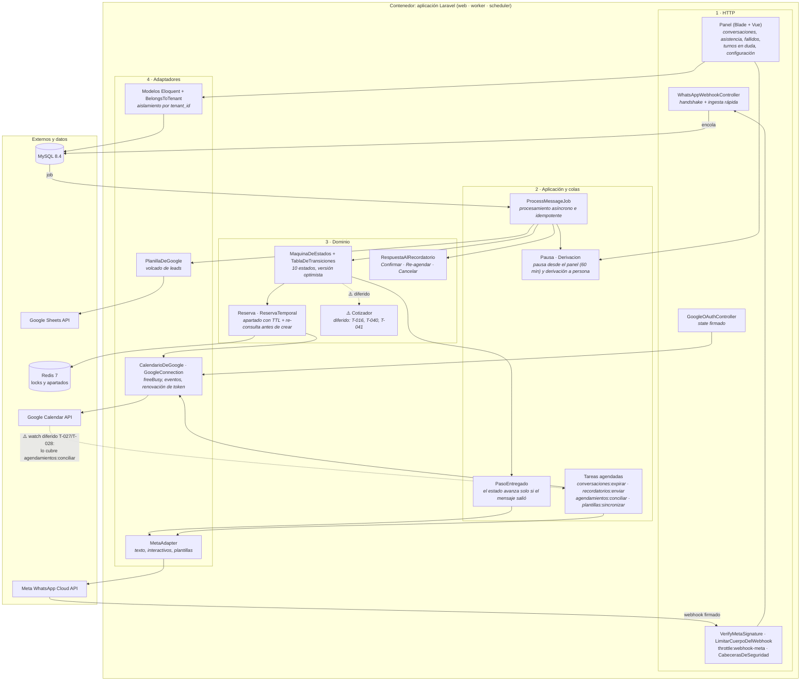

# C4 nivel 3 · Componentes del backend Laravel

> **Actualizado el 2026-11-03 contra el código.** La versión anterior dibujaba piezas que nunca se construyeron:
> - un *Quote Calculator Engine*, cuando el cotizador quedó diferido (T-016, T-040, T-041);
> - un *Human Takeover Detector* que leía pausas en Redis, cuando con el modelo de dos números (RF-A4) la pausa se activa **desde el panel** y vive en la base;
> - un webhook de *Sync Inversa Watch* de Google, cuando el watch quedó diferido (T-027, T-028, decisión § 9) y lo reemplaza la conciliación cada 15 minutos.
>
> Lo diferido aparece abajo con línea punteada y marcado con ⚠️, para que no se lea como existente.

## Componentes

| Componente | Responsabilidad | Dónde |
| :-- | :-- | :-- |
| **Guardas del webhook** | Límite de pedidos y de tamaño, y firma HMAC sobre el cuerpo crudo, **antes** de tocar código de aplicación (OWASP A06/A08) | `app/Http/Middleware/` |
| **ProcessMessageJob** | Resuelve la conversación, deduplica por `wamid`, persiste el mensaje y lo entrega al flujo | `app/Jobs/` |
| **PasoEntregado** | Si el mensaje del paso no se entrega, deshace la transición para que el reintento recorra el mismo camino (AC-09.4) | `app/Conversacion/` |
| **MaquinaDeEstados** | Transiciones declaradas en una tabla; versión optimista contra botones viejos | `app/Conversacion/` |
| **Reserva / ReservaTemporal** | Apartado del horario en Redis (TTL 5 min) y re-consulta a Google antes de crear el evento (T-029) | `app/Conversacion/` |
| **Pausa / Derivacion** | El operador pausa el bot desde el panel; el bot deriva a una persona tras intentos fallidos | `app/Conversacion/` |
| **Tareas agendadas** | Expirar conversaciones, recordatorio t-24h, conciliar con Google y sincronizar plantillas | `routes/console.php` |
| **Adaptadores** | Únicos puntos que hablan con Meta y Google; URL base configurable para el simulador | `app/Meta/`, `app/Services/Google/` |

⚠️ **Lo que el diagrama no tiene y figuraba antes:** el cotizador, el watch de Google y el aviso t-2h. Los tres están diferidos o recortados; ver `tickets/README.md`.
