```mermaid
erDiagram
    %% Actualizado al esquema real (SHOW CREATE TABLE sobre MySQL 8.4) el 2026-11-02.
    %% Solo tablas de negocio: las de infraestructura de Laravel (jobs, cache,
    %% sessions, failed_jobs, migrations, personal_access_tokens, ...) no se dibujan.

    TENANTS |o--o{ USERS : "tiene personal"
    TENANTS ||--|| BUSINESS_SETTINGS : "se configura con"
    TENANTS ||--o| LEAD_SPREADSHEETS : "vuelca leads en"
    TENANTS ||--o{ INTEGRATIONS : "conecta"
    TENANTS ||--o{ CONVERSATIONS : "atiende"
    TENANTS ||--o{ MESSAGES : "aisla"
    TENANTS ||--o{ PROCESSED_MESSAGES : "deduplica"
    TENANTS ||--o{ BOOKINGS : "administra"
    TENANTS ||--o{ NOTIFICATION_LOGS : "aisla"
    TENANTS ||--o{ RECONCILIATION_FINDINGS : "aisla"
    CONVERSATIONS ||--o{ MESSAGES : "contiene"
    CONVERSATIONS |o--o{ BOOKINGS : "genera"
    INTEGRATIONS ||--o{ BOOKINGS : "aloja el evento de"
    BOOKINGS ||--o{ NOTIFICATION_LOGS : "audita envios de"
    BOOKINGS ||--o{ RECONCILIATION_FINDINGS : "queda en duda por"
    USERS |o--o{ BOOKINGS : "marca asistencia de"
    USERS |o--o{ RECONCILIATION_FINDINGS : "resuelve"

    TENANTS {
        char36 id PK "UUID"
        varchar255 name
        varchar100 slug UK
        enum status "'active' | 'suspended' | 'trial'"
        varchar50 timezone "default America/Argentina/Buenos_Aires"
        timestamp created_at
        timestamp updated_at
    }

    USERS {
        bigint_unsigned id PK "BIGINT, no UUID (ver modelo de datos)"
        char36 tenant_id FK "nullable; UK(tenant_id, email)"
        varchar255 name
        varchar255 email "UK(tenant_id, email)"
        timestamp email_verified_at "nullable"
        varchar255 password
        enum role "'owner' | 'admin' | 'staff' (default staff)"
        varchar100 remember_token "nullable"
        timestamp created_at
        timestamp updated_at
    }

    BUSINESS_SETTINGS {
        bigint_unsigned id PK
        char36 tenant_id FK, UK "una fila por tenant"
        json business_hours "rangos por dia, hora LOCAL"
        smallint_unsigned slot_duration_minutes "default 30"
        smallint_unsigned buffer_minutes "default 10"
        smallint_unsigned search_window_days "default 7"
        text welcome_message
        text fallback_message
        text no_availability_message "nullable"
        varchar50 human_phone "nullable"
        timestamp created_at
        timestamp updated_at
    }

    LEAD_SPREADSHEETS {
        bigint_unsigned id PK
        char36 tenant_id FK, UK "un negocio, una planilla"
        varchar191 spreadsheet_id UK "unico global: no se comparte"
        varchar191 sheet_name
        timestamp created_at
        timestamp updated_at
    }

    INTEGRATIONS {
        bigint_unsigned id PK
        char36 tenant_id FK
        enum provider "'meta_whatsapp' | 'google_calendar' | 'outlook_calendar' | 'google_sheets'; UK(provider, account_identifier)"
        varchar255 account_identifier "phone_number_id o cuenta Google; UK(provider, account_identifier)"
        text access_token "nullable, cifrado (cast encrypted)"
        text refresh_token "nullable, cifrado (cast encrypted)"
        timestamp expires_at "nullable"
        text settings "nullable, cifrado (encrypted:array)"
        enum status "'connected' | 'disconnected' | 'expired'"
        timestamp created_at
        timestamp updated_at
    }

    CONVERSATIONS {
        bigint_unsigned id PK
        char36 tenant_id FK
        varchar50 user_phone "IDX(tenant_id, user_phone), no unico"
        varchar255 user_name "nullable"
        varchar100 current_state "default IDLE"
        int_unsigned state_version "default 0, sella botones"
        json context_data "nullable"
        varchar191 lead_sheet_id "nullable, planilla donde se escribio"
        int_unsigned lead_sheet_row "nullable, fila del upsert"
        varchar50 handoff_reason "nullable"
        timestamp handoff_at "nullable"
        timestamp handoff_resolved_at "nullable"
        timestamp last_interaction_at
        timestamp created_at
        timestamp updated_at
    }

    MESSAGES {
        bigint_unsigned id PK
        char36 tenant_id FK
        bigint_unsigned conversation_id FK
        enum direction "'inbound' | 'outbound'"
        varchar50 type "lo define Meta"
        text content "nullable"
        json payload "nullable"
        varchar255 whatsapp_message_id "nullable; UK(tenant_id, whatsapp_message_id)"
        timestamp created_at
        timestamp updated_at
    }

    PROCESSED_MESSAGES {
        bigint_unsigned id PK
        char36 tenant_id FK
        varchar255 message_id "wamid; UK(tenant_id, message_id)"
        timestamp processed_at
    }

    BOOKINGS {
        bigint_unsigned id PK
        char36 tenant_id FK
        bigint_unsigned conversation_id FK "nullable, SET NULL"
        bigint_unsigned integration_id FK
        varchar255 external_event_id "id del evento en Google"
        varchar255 live_event_id "GENERADA; UK(tenant_id, live_event_id)"
        varchar255 client_name
        varchar50 client_phone
        varchar150 service_name
        decimal quote_amount "nullable (10,2)"
        datetime start_time "UTC"
        datetime end_time "UTC"
        enum status "'scheduled' | 'confirmed' | 'rescheduled' | 'cancelled'"
        enum attendance "'pending' | 'attended' | 'no_show'"
        bigint_unsigned attendance_marked_by FK "nullable, users.id"
        timestamp attendance_marked_at "nullable"
        timestamp created_at
        timestamp updated_at
    }

    NOTIFICATION_LOGS {
        bigint_unsigned id PK
        char36 tenant_id FK
        bigint_unsigned booking_id FK "UK(booking_id, type)"
        enum type "'reminder_24h' | 'reminder_2h' | 'confirmation'"
        varchar255 whatsapp_message_id "nullable"
        enum status "'queued' | 'sent' | 'delivered' | 'read' | 'failed'"
        varchar500 failure_reason "nullable"
        timestamp sent_at "nullable"
        timestamp failed_at "nullable"
        timestamp created_at
        timestamp updated_at
    }

    RECONCILIATION_FINDINGS {
        bigint_unsigned id PK
        char36 tenant_id FK "UK(tenant_id, type, booking_id)"
        bigint_unsigned booking_id FK
        varchar64 type "hoy solo booking_without_event"
        timestamp detected_at
        timestamp resolved_at "nullable"
        bigint_unsigned resolved_by FK "nullable, users.id"
        varchar32 resolution "nullable: kept | cancelled"
        timestamp created_at
        timestamp updated_at
    }
```

> ⚠️ **`quote_rules` no está en el diagrama porque no existe en la base.** El cotizador paramétrico (RF-C1, US-12) quedó diferido por el recorte Pareto —T-016, T-040 y T-041— y la tabla nunca se migró. Figuraba en la versión anterior de este DER y en el DDL original de [`04-modelo-de-datos.md`](04-modelo-de-datos.md); se vuelve a dibujar el día que exista una migración que la cree.
