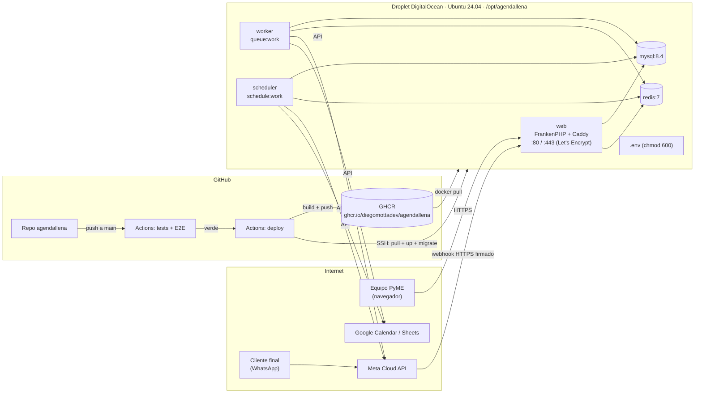

# Despliegue en producción

> **Estado:** preparado, sin desplegar. Falta crear el droplet y el subdominio.
> Todo lo de abajo está listo para cuando existan.

## Arquitectura de producción

Un solo droplet de DigitalOcean con Docker. La misma imagen corre los tres procesos de la app, y MySQL y Redis viven en el mismo servidor.



| Pieza | Archivo | Qué hace |
| :-- | :-- | :-- |
| Imagen | [`docker/prod/Dockerfile`](https://github.com/diegomottadev/agendallena/blob/main/docker/prod/Dockerfile) | Multi-stage: assets con Node, vendor sin dev, runtime FrankenPHP 1.11 con PHP 8.4 y `timezonedb` (tzdata al día, T-031). |
| Arranque | [`docker/prod/entrypoint.sh`](https://github.com/diegomottadev/agendallena/blob/main/docker/prod/entrypoint.sh) | Cachea config, rutas y vistas con el `.env` ya montado. |
| Servicios | [`docker-compose.prod.yml`](https://github.com/diegomottadev/agendallena/blob/main/docker-compose.prod.yml) | `web`, `worker`, `scheduler`, `mysql` y `redis`, con volúmenes persistentes. |
| CD | [`.github/workflows/deploy.yml`](https://github.com/diegomottadev/agendallena/blob/main/.github/workflows/deploy.yml) | Tras `tests` en verde sobre `main`: build, push a GHCR, SSH al droplet, `pull`, `up -d`, `migrate --force` y `queue:restart`. |
| Variables | [`.env.production.example`](https://github.com/diegomottadev/agendallena/blob/main/.env.production.example) | Plantilla del `.env` del servidor. |

**Por qué así:**
- **FrankenPHP:** trae Caddy adentro y saca solo el certificado HTTPS que Meta exige para el webhook, sin nginx ni certbot.
- **Un solo droplet:** alcanza para los pilotos y respeta el costo del lean canvas (USD 20-40/mes).
- **Worker y scheduler separados:** son dos procesos que se caen por separado, tal como los dibuja el C4 de contenedores.

## Gestión de secretos

| Secreto | Dónde vive | Nunca en |
| :-- | :-- | :-- |
| `APP_KEY`, contraseñas de la base, `META_*`, `GOOGLE_CLIENT_*` | `/opt/agendallena/.env` en el droplet, `chmod 600`, dueño `deploy` | El repo, la imagen o los logs de Actions |
| Tokens OAuth de cada PyME | Tabla `integrations`, encriptados con `APP_KEY` | Variables de entorno |
| Acceso SSH del CD | GitHub → *Secrets*: `DO_HOST`, `DO_USER`, `DO_SSH_KEY` (clave dedicada, solo para deploy) | Archivos del repo |
| Publicar la imagen | `GITHUB_TOKEN` del workflow (`packages: write`) | — |

- `.dockerignore` excluye `.env*` del contexto de build, así que la imagen nunca contiene secretos. Se verificó que `/app/.env` no existe en la imagen.
- El simulador (`/dev/*`) **no existe en producción**: `SoloConSimulador` lo corta con `APP_ENV=production` aunque `META_SIMULADOR` quede encendido. Se verificó con la imagen de producción: devuelve `404`.

## Primera puesta en marcha (cuando exista el droplet)

1. **Droplet:** Ubuntu 24.04, Basic de 2 GB (alrededor de USD 12/mes; con 1 GB, MySQL 8.4 queda justo). Agregá tu clave SSH al crearlo.
2. **DNS:** un registro `A` del subdominio (por ejemplo `agendallena.tudominio.com`) apuntando a la IP del droplet. Esperá a que propague antes del primer `up`, porque Caddy necesita resolver el dominio para sacar el certificado.
3. **Servidor:**
   ```bash
   ssh root@IP
   curl -fsSL https://get.docker.com | sh
   adduser --disabled-password deploy && usermod -aG docker deploy
   mkdir -p /opt/agendallena && chown deploy: /opt/agendallena
   ufw allow OpenSSH && ufw allow 80 && ufw allow 443 && ufw --force enable
   ```
4. **Clave de deploy:** generá un par **solo para el CD** (`ssh-keygen -t ed25519 -f deploy_agendallena`). La pública va a `/home/deploy/.ssh/authorized_keys` y la privada al secret `DO_SSH_KEY`.
5. **`.env` del servidor:** copiá `.env.production.example` a `/opt/agendallena/.env` y completalo (`DOMAIN`, `APP_KEY`, contraseñas, Meta y Google). Después `chmod 600 .env`. Para la `APP_KEY`, en tu máquina: `docker compose exec app php artisan key:generate --show`.
6. **Imagen privada:** si el paquete de GHCR queda privado, en el droplet corré `docker login ghcr.io` con un token de solo lectura (`read:packages`). Si no, hacé público el paquete.
7. **GitHub** (repo `agendallena`, Settings → Secrets and variables → Actions):
   - **Secrets:** `DO_HOST` (la IP), `DO_USER` (`deploy`) y `DO_SSH_KEY`.
   - **Variables:** `DOMAIN` (el subdominio) y **`DEPLOY_ENABLED=true`**. Esta última enciende el workflow.
   - Creá el *environment* `produccion` si querés aprobación manual antes de cada deploy.
8. **Primer deploy:** *Actions → deploy → Run workflow*. Después, en el droplet, cargá un negocio y su cuenta:
   ```bash
   cd /opt/agendallena
   docker compose -f docker-compose.prod.yml exec web php artisan cuenta:dar-de-alta   # ver --help
   ```
9. **Meta:** en el portal de desarrolladores, registrá `https://SUBDOMINIO/api/v1/webhooks/whatsapp` con el `verify_token` del tenant. Debe validar en verde (CA-01).
10. **Google:** agregá `https://SUBDOMINIO/api/v1/oauth/google/callback` como URI de redirección autorizada del cliente OAuth.

## Operación

```bash
cd /opt/agendallena
docker compose -f docker-compose.prod.yml ps
docker compose -f docker-compose.prod.yml logs -f web worker scheduler
docker compose -f docker-compose.prod.yml exec mysql \
  sh -c 'mysqldump -uroot -p"$MYSQL_ROOT_PASSWORD" agendallena' | gzip > backup-$(date +%F).sql.gz
```

⚠️ **Pendiente cuando se despliegue:**
- Backups automáticos de la base (los *Backups* del droplet o un cron con `mysqldump` hacia Spaces).
- Alertas de que el worker o el scheduler están caídos.
- Rotación de logs.
