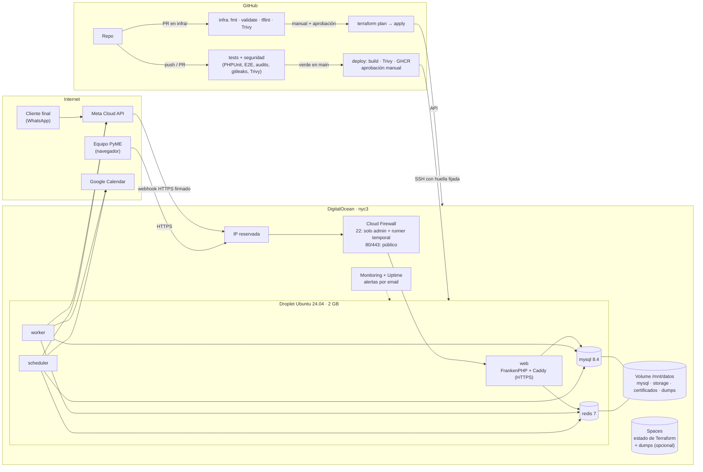

# Despliegue en producción

> **Estado:** preparado, sin desplegar. Falta crear la cuenta de DigitalOcean y el subdominio.
> La infraestructura está escrita en Terraform (`infra/terraform`) y el CD en GitHub Actions; los dos están apagados hasta que existan.

## Arquitectura

Un droplet de DigitalOcean con Docker, aprovisionado con Terraform. Corre la misma imagen en tres procesos (web, worker y scheduler), con MySQL y Redis en el mismo servidor. **Los datos viven en un Volume aparte**, así que recrear el droplet no toca la base.



| Pieza | Archivo | Qué hace |
| :-- | :-- | :-- |
| Infraestructura | [`infra/terraform/`](../infra/terraform) | Droplet, Volume, IP reservada, VPC, firewall, DNS opcional, alertas, chequeo de disponibilidad y bucket de backups. |
| Aprovisionamiento | [`cloud-init.yaml.tftpl`](../infra/terraform/cloud-init.yaml.tftpl) | Usuarios `admin` y `deploy`, SSH endurecido, fail2ban, actualizaciones automáticas, Docker, Volume montado, swap, rotación de logs y dump diario. |
| Imagen | [`docker/prod/Dockerfile`](../docker/prod/Dockerfile) | Multi-stage, FrankenPHP 1.13.4 con PHP 8.4 y parches de Debian aplicados en cada build. |
| Servicios | [`docker-compose.prod.yml`](../docker-compose.prod.yml) | `web`, `worker`, `scheduler`, `mysql` y `redis`, con los datos en `DATA_DIR`. |
| Script de deploy | [`scripts/deploy/desplegar.sh`](../scripts/deploy/desplegar.sh) | Dump previo, pull, up, migraciones, reinicio de la cola, chequeo de salud y **rollback automático**. |
| CD | [`.github/workflows/deploy.yml`](../.github/workflows/deploy.yml) | Exige `tests` y `seguridad` en verde, escanea la imagen, pide aprobación y despliega. |
| IaC en CI | [`.github/workflows/infra.yml`](../.github/workflows/infra.yml) | Valida en cada PR; `plan` y `apply` solo a mano, con aprobación. |

## Controles de seguridad

| Riesgo | Control |
| :-- | :-- |
| SSH expuesto a internet | El firewall de DigitalOcean admite el puerto 22 **solo desde las IPs de administración**. El CD agrega la IP del runner durante el deploy y la quita al terminar, aunque falle. |
| Acceso con contraseña o como root | `PermitRootLogin no`, `PasswordAuthentication no`, `AllowUsers admin deploy`, más fail2ban. |
| Servidor sin parches | `unattended-upgrades` diario. La imagen se reconstruye con `apt upgrade` y pasa Trivy antes de publicarse. |
| Suplantación del servidor (MITM) en el deploy | `StrictHostKeyChecking yes` con la huella guardada en `DO_SSH_KNOWN_HOSTS`. |
| Credenciales filtradas | El token de DigitalOcean del CD tiene scope mínimo (solo firewall). El de GHCR viaja por stdin. La clave SSH se borra del runner. Nada sensible en `terraform.tfvars` ni en git. |
| Salida abierta a cualquier puerto | Egress limitado a 443, 80, 53, 123 y 587. |
| Pérdida de datos | Volume con `prevent_destroy`, dump diario con 14 días de retención, dump previo a cada migración y copia opcional a Spaces. |
| Caídas que nadie ve | Alertas de CPU, memoria y disco, chequeo externo de `/up` y alerta de certificado por vencer. |
| Cambios de infraestructura sin revisar | `plan` publicado en el resumen del job; `apply` aplica ese mismo plan después de la aprobación del entorno `infra`. |

**Riesgos aceptados**, documentados en el código: 80/443 abiertos a todo internet, porque es una app web pública y Meta no publica IPs estables; y el destino de salida abierto, porque las APIs de Meta y Google no tienen IPs fijas.

## Primera puesta en marcha

### 1. Cuenta y credenciales (una vez)

1. En DigitalOcean, crear dos **tokens de API**:
   - `DO_TOKEN`: lectura y escritura completa, solo para Terraform.
   - `DO_TOKEN_FIREWALL`: *custom scopes*, solo `firewall:read` y `firewall:update`, para el CD.
2. Crear una **clave de Spaces** y un bucket privado `agendallena-tfstate` con versionado activado. Ahí vive el estado de Terraform.
3. Generar dos pares de claves SSH:
   ```bash
   ssh-keygen -t ed25519 -f ~/.ssh/agendallena_admin   -C admin
   ssh-keygen -t ed25519 -f ~/.ssh/agendallena_deploy  -C github-actions-deploy
   ```

### 2. Aprovisionar con Terraform

En local:

```bash
cd infra/terraform
cp backend.hcl.example backend.hcl
cp terraform.tfvars.example terraform.tfvars        # claves públicas, tu IP /32 y email
export DIGITALOCEAN_TOKEN=...                       # DO_TOKEN
export AWS_ACCESS_KEY_ID=... AWS_SECRET_ACCESS_KEY=...   # clave de Spaces
terraform init -backend-config=backend.hcl
terraform plan
terraform apply
terraform output                                    # ip_publica, firewall_id, webhook_meta
```

También desde GitHub: **Actions → infra → Run workflow → plan**, y después **apply**, que requiere aprobación. Antes hay que cargar en los entornos `infra-plan` e `infra` los secretos `DO_TOKEN`, `SPACES_KEY` y `SPACES_SECRET`, y las variables `SSH_PUBLICA_ADMIN`, `SSH_PUBLICA_DEPLOY`, `IPS_ADMIN` (por ejemplo `["203.0.113.10/32"]`), `EMAIL_ALERTAS`, `DOMINIO`, `SUBDOMINIO` y `TF_BACKEND_HCL` (el contenido de `backend.hcl`).

### 3. DNS

Un registro **A** del subdominio que apunte a `ip_publica`. Si el dominio usa los nameservers de DigitalOcean, `gestionar_dns = true` lo crea solo. Esperá a que propague: Caddy necesita resolverlo para sacar el certificado.

### 4. `.env` del servidor

Completá en tu máquina una copia de `.env.production.example` y subila:

```bash
scp -i ~/.ssh/agendallena_admin .env.production admin@IP:/tmp/.env
ssh -i ~/.ssh/agendallena_admin admin@IP \
  'sudo install -o deploy -g deploy -m 600 /tmp/.env /opt/agendallena/.env && rm /tmp/.env'
```

`APP_KEY` en local: `docker compose exec app php artisan key:generate --show`.

### 5. GitHub: entorno `produccion`

En **Settings → Environments → produccion**:

| Tipo | Nombre | Valor |
| :-- | :-- | :-- |
| Protección | Required reviewers | Vos |
| Secret | `DO_HOST` | `ip_publica` |
| Secret | `DO_SSH_KEY` | Contenido de `~/.ssh/agendallena_deploy` (privada) |
| Secret | `DO_SSH_KNOWN_HOSTS` | Salida de `ssh-keyscan -t ed25519 IP` |
| Secret | `DO_TOKEN_FIREWALL` | El token con scope de firewall |
| Variable | `DO_FIREWALL_ID` | `firewall_id` |
| Variable | `DOMAIN` | El subdominio |

Y en **Settings → Secrets and variables → Actions → Variables** del repositorio: `DEPLOY_ENABLED=true`. Esa variable enciende el CD.

### 6. Primer deploy y alta del negocio

**Actions → deploy → Run workflow**, y después:

```bash
ssh -i ~/.ssh/agendallena_admin admin@IP
cd /opt/agendallena && docker compose -f docker-compose.prod.yml exec web php artisan cuenta:dar-de-alta --help
```

### 7. Meta y Google

- **Meta:** registrar `webhook_meta` con el `verify_token` del tenant. Tiene que validar en verde (CA-01).
- **Google:** agregar `https://SUBDOMINIO/api/v1/oauth/google/callback` como URI de redirección autorizada.

## Cómo se hace cada deploy

Cada merge a `main` dispara `tests`. Si queda en verde, `deploy` arranca solo:

1. **Verificar:** `tests` y `seguridad` tienen que estar en verde para ese commit exacto.
2. **Imagen:** se construye la imagen, Trivy la escanea (cualquier CVE crítica o alta con arreglo la frena) y se publica en GHCR con el SHA como tag.
3. **Aprobación:** el entorno `produccion` espera tu OK.
4. **Desplegar:** se abre SSH solo para la IP del runner y se ejecuta `desplegar.sh`:
   1. **dump de la base** a `pre-deploy.sql.gz`;
   2. `pull` y `up -d` de la imagen nueva;
   3. **`php artisan migrate --force`**;
   4. `queue:restart`, para que el worker tome el código nuevo;
   5. chequeo de salud de `https://DOMINIO/up` durante un minuto;
   6. si no responde sano, **rollback a la imagen anterior** y el job queda en rojo.
5. Se cierra el SSH y se verifica `/up` desde afuera.

### Migraciones: reglas para que el deploy sea seguro

- **Corren solas en cada deploy**: no hay que entrar al servidor. `migrate --force` aplica solo las pendientes; si no hay ninguna, no hace nada.
- **El rollback revierte la imagen, no la base.** Por eso cada migración tiene que ser compatible con la versión anterior del código (*expand/contract*):
  - **Agregar** una columna o tabla: se puede en un solo deploy.
  - **Renombrar o borrar** una columna: en dos deploys. Primero se agrega lo nuevo y el código usa las dos; en el siguiente, se borra lo viejo.
  - **Nunca** un `migrate:rollback` automático en producción.
- **Para volver atrás de verdad**, existe `pre-deploy.sql.gz`, el dump tomado justo antes de migrar:
  ```bash
  gunzip -c /opt/agendallena/pre-deploy.sql.gz | docker compose -f docker-compose.prod.yml exec -T mysql sh -c 'mysql -uroot -p"$MYSQL_ROOT_PASSWORD" "$MYSQL_DATABASE"'
  ```
- Una migración que bloquea tablas grandes (índice sobre millones de filas) se corre fuera de horario con `workflow_dispatch`.

## Operación

```bash
cd /opt/agendallena
docker compose -f docker-compose.prod.yml ps
docker compose -f docker-compose.prod.yml logs -f web worker scheduler
sudo /usr/local/bin/agendallena-backup            # dump manual
ls -lh /mnt/datos/backups
```

⚠️ **Pendiente cuando se despliegue:** la alerta específica de *worker* o *scheduler* caídos. Hoy la cubre en parte el monitoreo del droplet, pero no ve un contenedor muerto con la app respondiendo. Se resuelve con un `healthcheck` en el compose o con un *heartbeat* del scheduler hacia un servicio externo.
