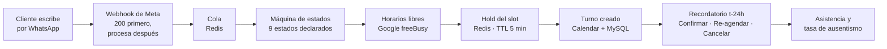
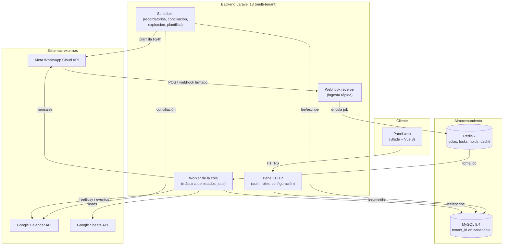
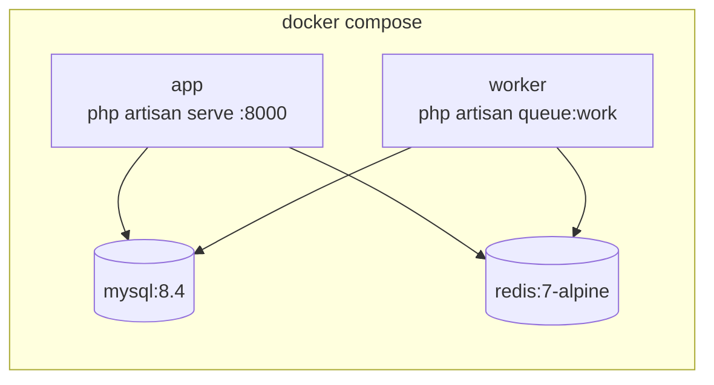

## Índice

0. [Ficha del proyecto](#0-ficha-del-proyecto)
1. [Descripción general del producto](#1-descripción-general-del-producto)
2. [Arquitectura del sistema](#2-arquitectura-del-sistema)
3. [Modelo de datos](#3-modelo-de-datos)
4. [Especificación de la API](#4-especificación-de-la-api)
5. [Historias de usuario](#5-historias-de-usuario)
6. [Tickets de trabajo](#6-tickets-de-trabajo)
7. [Pull requests](#7-pull-requests)

> **Dónde está cada cosa.** Este README es el resumen que pide la plantilla. La documentación completa vive en [`.claude/docs/`](.claude/docs/README.md): PRD, lean canvas, C4, DER, flujos, 26 historias, 50 tickets, story maps, estimación y decisiones. [`CLAUDE.md`](CLAUDE.md) es el contexto con el que trabajan los agentes de IA del proyecto. El código está en [diegomottadev/agendallena](https://github.com/diegomottadev/agendallena).

---

## 0. Ficha del proyecto

### **0.1. Tu nombre completo:**

Diego Motta

### **0.2. Nombre del proyecto:**

AgendaLlena

### **0.3. Descripción breve del proyecto:**

Middleware de agendamiento por WhatsApp para PyMEs latinoamericanas de 3 a 20 empleados. El cliente escribe al WhatsApp del negocio y el bot le contesta en segundos. Le ofrece solo los horarios que están **realmente libres** en el Google Calendar del negocio, reserva el turno y lo confirma 24 horas antes con botones de Confirmar, Re-agendar y Cancelar. La PyME no cambia de herramientas: sigue usando su WhatsApp, su Google Calendar y su Google Sheets.

### **0.4. URL del proyecto:**

⚠️ **Pendiente.** Todavía no hay un entorno público desplegado; se publica en la entrega final. Mientras tanto se puede correr en local con Docker (ver [1.4](#14-instrucciones-de-instalación)).

### 0.5. URL o archivo comprimido del repositorio

- Código: https://github.com/diegomottadev/agendallena
- Entrega del máster (este repo): https://github.com/diegomottadev/agendallenaia

---

## 1. Descripción general del producto

### **1.1. Objetivo:**

Una PyME latinoamericana pierde plata por dos agujeros que nadie mide:

| Problema | Cuánto duele | Cómo se resuelve hoy |
| :-- | :-- | :-- |
| **Tarda horas en contestar un WhatsApp** | Quien pide un turno y no recibe respuesta en minutos le escribe al negocio de al lado | Alguien contesta cuando puede, entre cliente y cliente |
| **Entre el 20% y el 35% de los turnos no se presentan** | Una silla vacía que ya estaba paga | Nada; nadie llama para confirmar |
| **Rechaza los CRMs** | Ya les pidieron cambiar de herramienta y no lo hacen | WhatsApp y una planilla |

**Propuesta de valor:** *agendar el 100% de las consultas de WhatsApp en menos de 15 segundos, sin cambiar de herramientas.*

**Para quién:** PyMEs de 3 a 20 empleados de salud y estética, inmobiliarias, distribuidoras B2B y servicios de mantenimiento.

**KPIs del MVP** ([PRD §2](.claude/docs/01-producto/02-prd.md)):
- Respuesta automática en menos de 15 s.
- Asistencia de al menos 92% en los pilotos (ausentismo por debajo del 8%).
- Al menos 35% de los chats terminan en reserva.
- Puesta en marcha de una PyME en menos de 60 minutos.

Modelo de negocio ([lean canvas](.claude/docs/01-producto/01-lean-canvas.md)): SaaS multi-tenant con un setup de USD 100-300 y un abono plano de USD 80-150 por mes.

### **1.2. Características y funcionalidades principales:**

**Cliente final (por WhatsApp)**
- **Bienvenida y menú** con botones interactivos de Meta (US-16).
- **Horarios realmente libres:** se consulta `freeBusy` de Google Calendar y se aplican el horario de atención, la duración del turno y el buffer entre turnos. Se muestran en una lista interactiva con paginado (US-05, US-19).
- **Reserva consistente:** un hold de 5 minutos en Redis, un control de colisión al confirmar y la creación del evento en Calendar. Dos clientes no pueden quedarse con el mismo horario (US-06, US-18, US-22).
- **Recordatorio t-24 h** con plantilla aprobada por Meta y botones Confirmar, Re-agendar y Cancelar. Cancelar libera el horario en Calendar (US-10, US-11).
- **Fallback:** si Google o Meta fallan, el cliente recibe un mensaje de cortesía y la conversación nunca queda colgada (US-09).
- **Derivación a una persona** a un segundo número atendido por humanos (US-20).

**Equipo de la PyME (panel web)**
- Login con roles **dueño, administrador y equipo** y aislamiento estricto entre negocios (US-14).
- Conversaciones: lista, detalle con el historial completo, y pausar o reactivar el bot (US-21).
- Configuración de agenda (horarios, duración, buffer) y de mensajes (bienvenida, fallback, sin disponibilidad) (US-15).
- Registro de asistencia y tasa de ausentismo (US-17).
- Recordatorios que no salieron, con reintento (US-24).
- Turnos en duda: una conciliación periódica detecta cuando Google y la base se desincronizaron.
- Estado de las integraciones: Meta, Google Calendar y Google Sheets (US-25).
- Vinculación de una planilla de Google Sheets donde se vuelcan los leads (US-13, US-26).

**Plataforma**
- Webhook de Meta con handshake, firma HMAC y respuesta `200` antes de procesar (US-01, US-02).
- Máquina de estados declarada: 9 estados con transiciones explícitas, idempotencia y lock por conversación (US-03).
- Todo se guarda en UTC y se muestra en la zona horaria del negocio, con una suite que detecta reglas de husos derogadas (US-07).

**Fuera del MVP**, con la decisión documentada en el [PRD](.claude/docs/01-producto/02-prd.md): cotizador paramétrico, sincronización inversa por *watch* de Google, Outlook, cobro de señas y editor visual de flujos.

### **1.3. Diseño y experiencia de usuario:**

⚠️ **Pendiente:** capturas del chat y del panel, y un video de 2-3 minutos con el flujo principal. Se agregan con la entrega del código funcional.

Mientras tanto, el recorrido está documentado en:
- [Flujo de WhatsApp del cliente final](.claude/docs/03-flujos/04-flujo-whatsapp-cliente-final.md)
- [Estados del flujo conversacional](.claude/docs/03-flujos/05-estados-flujo-conversacional.md)
- [Secuencia end-to-end de agendamiento](.claude/docs/03-flujos/06-secuencia-agenda-cotizacion-e2e.md)
- Casos de uso: [general](.claude/docs/03-flujos/01-casos-de-uso-general.md), [cliente final](.claude/docs/03-flujos/02-casos-de-uso-cliente-final.md) y [equipo de la PyME](.claude/docs/03-flujos/03-casos-de-uso-equipo-pyme.md)



### **1.4. Instrucciones de instalación:**

**Requisitos:** Docker con Docker Compose. Todo lo demás corre en contenedores: PHP 8.4, MySQL 8.4 y Redis 7.

```bash
git clone https://github.com/diegomottadev/agendallena.git
cd agendallena
cp .env.example .env

docker compose up -d mysql redis
docker compose run --rm --no-deps app composer install
docker compose run --rm --no-deps app php artisan key:generate
docker compose run --rm --no-deps app sh -c "npm ci && npm run build"
docker compose up -d                                     # app (:8000) + worker de la cola

docker compose exec app php artisan migrate --seed
docker compose exec app php artisan db:seed --class=RolesDemoSeeder   # 2 negocios demo, contraseña "password"
```

- Panel: http://localhost:8000/login (por ejemplo `duenia@peluqueria-sur.test` / `password`).
- Tests: `docker compose exec app php artisan test`. La suite corre contra MySQL real, en la base `agendallena_testing`.
- Para integraciones reales hay que completar en `.env` las credenciales de Meta (`META_*`) y Google (`GOOGLE_*`).
- ⚠️ El `Dockerfile` usa `opcache.validate_timestamps=0`: el código que se edita no se ve hasta correr `docker compose restart app worker`.

---

## 2. Arquitectura del Sistema

### **2.1. Diagrama de arquitectura:**

C4 nivel 2, contenedores ([fuente](.claude/docs/02-arquitectura/01-c4-nivel-2-contenedores.md)):



**Patrón:** **monolito modular** en Laravel con **arquitectura orientada a eventos** para la ingesta: el webhook valida, encola y responde `200`, y el procesamiento ocurre en un worker. Las integraciones externas viven detrás de **adapters** (`MetaAdapter`, `GoogleConnection`, Sheets), al estilo puertos y adaptadores. El dominio conversacional es una **máquina de estados declarada** (`TablaDeTransiciones`): una transición que no está en la tabla lanza una excepción, no se improvisa.

**Por qué esta arquitectura:**
- **Meta exige responder rápido** y reintenta lo que no recibe `200`. Encolar desacopla la latencia de Google y de Meta de la respuesta del webhook (RF-A2).
- **Un solo desarrollador y un MVP:** un monolito con una cola alcanza para los volúmenes de los pilotos y evita la complejidad operativa de los microservicios.
- **Multi-tenant por columna** (`tenant_id` más *Global Scopes* de Eloquent) en lugar de base o schema por cliente. Un solo despliegue sirve a todas las PyMEs con aislamiento lógico (RNF-01).

**Costos aceptados:**
- Los *Global Scopes* no cubren `DB::table()`, `whereRaw()` ni joins manuales; ahí el filtro va explícito y se revisa en code review (agente `invariantes-auditor`).
- Los jobs y el scheduler no heredan el tenant: viaja en el payload.
- Con un solo worker, una ráfaga grande espera en la cola. Escalar es agregar workers.
- No hay sincronización inversa por *watch* de Google. Una **conciliación periódica** detecta los turnos que se movieron a mano y los marca "en duda" para que una persona los resuelva.

### **2.2. Descripción de componentes principales:**

| Componente | Tecnología | Responsabilidad |
| :-- | :-- | :-- |
| **Webhook receiver** (`WhatsAppWebhookController` + `VerifyMetaSignature`) | Laravel 13 | Handshake (`hub.challenge`), validación de la firma `X-Hub-Signature-256` y encolado del payload. Responde `200` sin procesar. |
| **ProcessMessageJob** | Laravel Queues sobre Redis | Resuelve el tenant por `phone_number_id`, deduplica (`processed_messages`), toma el lock de la conversación y ejecuta la transición. |
| **Máquina de estados** (`App\Conversacion`) | PHP 8.4 | 9 estados (`IDLE`, `GATHERING_PARAMS`, `SELECTING_SLOT`, `SLOT_SELECTED`, `BOOKED`, `CONFIRMED`, `CANCELLED`, `PAUSED_HUMAN`, `ERROR_FALLBACK`), transiciones declaradas, `state_version` para descartar botones vencidos. |
| **Disponibilidad y reserva** (`App\Services\Google`) | Google Calendar API | `freeBusy`, grilla de slots con horario, duración y buffer, hold temporal en Redis, colisión al confirmar y creación del evento. |
| **MetaAdapter** (`App\Meta`) | Meta Cloud API v21.0 | Envío de texto, mensajes interactivos (botones y listas) y plantillas. Persiste lo saliente en `messages`. Distingue el *rate limit*, que se reintenta, del rechazo definitivo. |
| **Recordatorios** (`App\Recordatorios`) | Scheduler + plantillas de Meta | Recordatorio t-24 h con botones y procesamiento de la respuesta (confirmar, re-agendar, cancelar). |
| **Leads** (`App\Leads`, `VolcarLeadJob`) | Google Sheets API | Vuelca cada conversación con datos, haya reservado o no, a la planilla del negocio. |
| **Panel** (`App\Http\Controllers\Panel`) | Blade + Vue 3 + Tailwind 4 (Vite 8) | Login, conversaciones, configuración, asistencia, recordatorios fallidos, turnos en duda y estado de las integraciones. |
| **Logging estructurado** (`App\Logging`) | Monolog | Contexto por tenant e integración, y redacción de secretos antes de escribir. |

### **2.3. Descripción de alto nivel del proyecto y estructura de ficheros**

Estructura estándar de Laravel 13. El dominio se organiza **por capacidad de negocio** y no por tipo técnico:

```
app/
├── Conversacion/        # Dominio: máquina de estados, reserva, reagendamiento, fallback, derivación, pausa
│   └── Interactivo/     #   Renderizado e interpretación de botones y listas de Meta (ids sellados)
├── Meta/                # Adapter de WhatsApp Cloud API: envío, plantillas, alta de cuenta, normalización de números
├── Services/Google/     # Adapter de Google: OAuth, renovación de tokens, freeBusy, eventos
├── Recordatorios/       # Plantilla t-24h y respuesta a sus botones
├── Leads/               # Fila de lead para Google Sheets
├── Panel/               # Lógica de lectura del panel (estado de integraciones, etc.)
├── Jobs/                # ProcessMessageJob (ingesta), VolcarLeadJob
├── Console/Commands/    # Tareas del scheduler: recordatorios, conciliación, expiración, plantillas
├── Http/
│   ├── Controllers/Api/   # Webhook de Meta y callback OAuth de Google
│   ├── Controllers/Panel/ # Pantallas del panel
│   └── Middleware/        # Firma de Meta, tenant de la sesión, roles
├── Models/              # Eloquent; BelongsToTenant aplica el Global Scope por tenant_id
├── Logging/             # Logging estructurado y redacción de secretos
└── Support/             # TenantContext, HoraLocal (conversión UTC ↔ zona del negocio)
database/migrations/     # Esquema (índices compuestos que lideran con tenant_id)
resources/views, js/     # Panel: Blade + componentes Vue 3
tests/Feature/           # Suite de comportamiento contra MySQL real
.claude/                 # Documentación de producto, agentes, skills y prompts (este repo)
```

### **2.4. Infraestructura y despliegue**

**Local y CI.** `docker-compose.yml` levanta 4 servicios:



- La imagen se construye desde un `Dockerfile` propio (PHP 8.4 CLI con `pdo_mysql`, `redis`, `bcmath`, `intl` y `opcache`). **La versión de tzdata es parte del contrato** porque los husos de la región cambian por decreto (T-031).
- **CI con GitHub Actions** (`.github/workflows/tests.yml`): en cada push y PR construye la imagen del proyecto, levanta MySQL y Redis y corre la suite completa. Se usa la imagen del proyecto, y no `setup-php`, para que los tests de husos corran con la misma tzdata que producción.
- **Secretos:** solo en `.env`, que no se versiona. Los tokens OAuth de cada PyME se guardan **encriptados** en la tabla `integrations`, nunca en variables de entorno.

⚠️ **Pendiente para la entrega final:**
- **Despliegue en un entorno público** (VPS de USD 20-40 por mes según el lean canvas) con php-fpm detrás de nginx, el worker y el scheduler como procesos supervisados, y HTTPS (Meta exige HTTPS para el webhook).
- **Pipeline de CD** y gestión de secretos en ese entorno.
- **Diagrama de despliegue** de producción.

### **2.5. Seguridad**

- **Firma de los webhooks:** todo `POST` de Meta se valida con HMAC SHA-256 (`X-Hub-Signature-256`) sobre el cuerpo crudo, en middleware y antes de tocar código de aplicación. Una firma ausente o inválida devuelve `401`.
- **Handshake por tenant:** el `verify_token` se busca entre las integraciones de cada PyME con comparación en tiempo constante (`hash_equals`). El token de un tenant no valida a otro.
- **Tokens encriptados en reposo:** `access_token`, `refresh_token` y `settings` de `integrations` usan el cast `encrypted` y están ocultos en la serialización (`$hidden`).
- **Aislamiento multi-tenant:** el trait `BelongsToTenant` aplica un *Global Scope* y falla si no hay tenant activo. Cruzar tenants exige escribir `withoutTenantScope()` a propósito. Hay tests que verifican que un tenant no ve datos de otro.
- **Roles en el panel:** dueño, administrador y equipo, aplicados con el middleware `rol:*` ([roles y permisos](.claude/docs/01-producto/05-roles-y-permisos.md)).
- **Redacción de secretos en los logs:** el procesador `RedactSecrets` elimina tokens y secretos antes de escribir. Los mensajes de error nombran al tenant y al código HTTP, nunca al token.
- **OAuth con `state` firmado** en el callback de Google, que además transporta el tenant.
- **CSRF y sesión** en el panel. Los webhooks van en el grupo `api`, sin sesión, y su autenticación es la firma.
- **Ids de botones sellados** (`IdSellado`): un botón de un mensaje viejo o manipulado no ejecuta una acción fuera de su estado.

### **2.6. Tests**

Más de **600 tests de comportamiento** (`tests/Feature/`) que corren **contra MySQL 8.4 real** y no contra SQLite, porque el esquema usa columnas generadas, ENUM y bloqueo de filas. El proyecto se desarrolló con **TDD estricto**: agentes `tdd-test-writer`, `tdd-implementer` y `tdd-refactorer`, cada uno limitado a su fase. Algunos ejemplos:

| Test | Qué garantiza |
| :-- | :-- |
| `FlujoReservaTest` | Recorrido E2E del bot: saludo, botón "Reservar", nombre, lista de horarios libres, reserva. Google y Meta están simulados con `Http::fake`. |
| `ColisionDeHorarioTest` / `IdempotenciaDelAgendamientoTest` | Dos clientes no se quedan con el mismo horario, y un webhook repetido no reserva dos veces. |
| `ZonasHorariasTransversalTest` | Conversiones UTC ↔ zona local correctas, incluidos países que eliminaron el horario de verano. Falla si la imagen retrocede de versión de tzdata. |
| `WhatsAppWebhookIngestionTest` / `WhatsAppWebhookVerificationTest` | Firma inválida → 401. Handshake con un token de otro tenant → 403. |
| `RecordatorioT24hTest` / `RespuestaAlRecordatorioT24hTest` | Envío en ventana sin duplicados. Confirmar pasa el turno a `confirmed`, cancelar libera el evento. |
| `FallbackTest` / `FallbackTercerosTest` | Ante la caída de Google o Meta, el cliente recibe el mensaje de cortesía y la conversación vuelve a `IDLE`. |
| `RolesYPermisosTest` / `ConsultasNMas1Test` | Permisos por rol y ausencia de consultas N+1 en el panel. |

⚠️ **Pendiente:** un test E2E de navegador del panel (la consigna pide al menos un E2E del flujo principal; hoy el E2E es del bot a nivel HTTP).

---

## 3. Modelo de Datos

### **3.1. Diagrama del modelo de datos:**

Esquema real de la base (migraciones al día). Las tablas de infraestructura de Laravel (`jobs`, `cache`, `sessions`, etc.) no se muestran.


### **3.2. Descripción de entidades principales:**

Dos reglas valen para todas las tablas:
- **Multi-tenancy (RNF-01):** todas las tablas de negocio llevan `tenant_id` (FK a `tenants.id`, `NOT NULL` salvo en `users`), y **todo índice compuesto lidera con `tenant_id`**.
- **Zonas horarias (RNF-02):** toda fecha se guarda en **UTC**. La zona del negocio vive en `tenants.timezone` y se aplica solo al mostrar.

| Entidad | Descripción | Relaciones y restricciones clave |
| :-- | :-- | :-- |
| **tenants** | Cada PyME cliente. PK UUID. | `slug` único. Tiene 1 `business_settings` y como mucho 1 `lead_spreadsheets`. |
| **users** | Personas del panel con rol `owner`, `admin` o `staff`. | N:1 con `tenants`. `UNIQUE(tenant_id, email)`: el mismo email puede existir en dos negocios. |
| **integrations** | Conexiones con Meta, Google Calendar y Google Sheets. `account_identifier` es el `phone_number_id` de Meta o el email de Google. | `UNIQUE(provider, account_identifier)`: un número de WhatsApp pertenece a un solo negocio, y así la ingesta resuelve el tenant. Tokens y `settings` encriptados. |
| **business_settings** | Reglas del negocio: horario por día (JSON), duración del turno, buffer, ventana de búsqueda, textos del bot y segundo número humano. | 1:1 con `tenants` (`tenant_id` único). |
| **lead_spreadsheets** | Planilla de Google Sheets donde se vuelcan los leads. | 1:1 con `tenants`. `spreadsheet_id` único. |
| **conversations** | Estado de la charla con cada cliente final: `current_state` de la máquina de estados, `context_data` con lo capturado, `state_version` para descartar botones vencidos y marcas de derivación. | N:1 con `tenants`. Índice `(tenant_id, user_phone)`. Es **la fuente de verdad del estado**; Redis solo hace de caché y lock. |
| **messages** | Historial completo de entrantes y salientes, con el payload original de Meta. | N:1 con `conversations`. `UNIQUE(tenant_id, whatsapp_message_id)`. Índice `(tenant_id, conversation_id, created_at)` para el detalle del panel. |
| **processed_messages** | Ids de mensajes de Meta ya procesados: idempotencia ante los reintentos del webhook. | `UNIQUE(tenant_id, message_id)`. |
| **bookings** | Turno reservado y sincronizado con un evento de Google Calendar. | N:1 con `conversations` (nullable) y con `integrations`. `live_event_id` es una **columna generada** que vale `external_event_id` solo si el turno está vivo; su `UNIQUE(tenant_id, live_event_id)` impide dos turnos vivos sobre el mismo evento sin bloquear los cancelados. `attendance` se guarda aparte de `status` para no perder que un turno confirmado terminó en ausencia. |
| **notification_logs** | Auditoría de los recordatorios y confirmaciones enviados, con su estado de entrega según Meta. | N:1 con `bookings`. `UNIQUE(booking_id, type)`: un turno no recibe dos veces el mismo recordatorio. |
| **reconciliation_findings** | Desincronizaciones detectadas entre Google y la base ("turnos en duda") y cómo se resolvieron. | N:1 con `bookings`. `resolved_by` es FK a `users`. `UNIQUE(tenant_id, type, booking_id)`. |

Detalle completo, con el DDL, en [`04-modelo-de-datos.md`](.claude/docs/02-arquitectura/04-modelo-de-datos.md). ⚠️ Ese documento y el [DER original](.claude/docs/02-arquitectura/03-der-entidad-relacion.md) son anteriores a varias migraciones (`messages`, `business_settings`, `lead_spreadsheets`, `processed_messages`, `reconciliation_findings`, asistencia). El diagrama de arriba es el vigente.

---

## 4. Especificación de la API

El backend expone pocos endpoints públicos: el resto es el panel, renderizado del lado del servidor con sesión. Los tres principales:

```yaml
openapi: 3.0.3
info:
  title: AgendaLlena API pública
  version: 1.0.0
servers:
  - url: http://localhost:8000/api/v1
paths:
  /webhooks/whatsapp:
    get:
      summary: Handshake del webhook de Meta (RF-A1)
      description: >
        Meta lo llama al registrar la URL. Si el verify_token corresponde a la
        integración de algún tenant, devuelve el challenge en texto plano.
      parameters:
        - { name: hub.mode, in: query, required: true, schema: { type: string, enum: [subscribe] } }
        - { name: hub.verify_token, in: query, required: true, schema: { type: string } }
        - { name: hub.challenge, in: query, required: true, schema: { type: string } }
      responses:
        '200':
          description: Token válido; devuelve el challenge.
          content: { text/plain: { schema: { type: string, example: "1158201444" } } }
        '403': { description: Parámetros incompletos o token que no corresponde a ningún tenant. }
    post:
      summary: Ingesta de mensajes y estados de WhatsApp (RF-A2)
      description: >
        Valida la firma HMAC SHA-256 sobre el cuerpo crudo, encola el payload
        (ProcessMessageJob) y responde 200 sin procesar. El tenant se resuelve
        por metadata.phone_number_id. Los reintentos de Meta se deduplican por id.
      parameters:
        - name: X-Hub-Signature-256
          in: header
          required: true
          schema: { type: string, example: "sha256=5f1c...e9" }
      requestBody:
        required: true
        content:
          application/json:
            example:
              object: whatsapp_business_account
              entry:
                - changes:
                    - field: messages
                      value:
                        metadata: { phone_number_id: "1053554814514902" }
                        contacts: [ { profile: { name: "María" }, wa_id: "5493764000000" } ]
                        messages:
                          - from: "5493764000000"
                            id: "wamid.HBgM..."
                            timestamp: "1793655028"
                            type: interactive
                            interactive:
                              type: list_reply
                              list_reply: { id: "slot|SELECTING_SLOT|3|...", title: "Lun 10:00" }
      responses:
        '200': { description: Recibido y encolado (también ante un cuerpo no decodificable, para que Meta no reintente). }
        '401': { description: Firma ausente o inválida. }
  /oauth/google/callback:
    get:
      summary: Callback del consentimiento de Google Calendar (RF-B1)
      description: >
        Google redirige acá después del consentimiento. El state firmado
        autentica la operación y transporta el tenant; se canjea el code por
        tokens, que se guardan encriptados en integrations.
      parameters:
        - { name: code, in: query, required: false, schema: { type: string } }
        - { name: state, in: query, required: true, schema: { type: string } }
        - { name: error, in: query, required: false, schema: { type: string, example: access_denied } }
      responses:
        '302':
          description: >
            Vuelve al panel. Con la integración conectada, o con
            ?google=cancelado si el usuario rechazó el consentimiento, o con
            ?google=error&motivo=state_invalido si el state no es válido.
```

---

## 5. Historias de Usuario

El backlog completo son **26 historias** en formato Como/Quiero/Para, con criterios BDD, requisitos técnicos, estimación, evaluación INVEST y trazabilidad al PRD ([índice](.claude/docs/01-producto/03-user-stories-mvp.md) · [story maps](.claude/docs/stories-maps/README.md)). Estas son tres de las principales:

**Historia de Usuario 1 · [US-03 · Máquina de estados conversacional](.claude/docs/stories/US-03-maquina-de-estados-conversacional.md)**

| Prioridad | Estimación | Trazabilidad |
| :-- | :-- | :-- |
| 3 de 14 | L | RF-A3 · RF-A5 |

> **Como** cliente final que consulta por WhatsApp entre otras cosas,
> **quiero** que el bot recuerde exactamente en qué punto quedó nuestra conversación,
> **para** no tener que repetir lo que ya contesté ni quedar trabado sin salida.

- **AC-03.1 · Retomar tras una pausa larga.** **Dado que** dejé la conversación en `GATHERING_PARAMS` hace 20 minutos habiendo dado mi nombre, **cuando** vuelvo a escribir, **entonces** el bot retoma en ese estado y no me pide los datos de nuevo.
- **AC-03.2 · Botón vencido.** **Dado que** la conversación avanzó a `SELECTING_SLOT`, **cuando** toco un botón de un mensaje anterior, **entonces** el bot responde con el paso actual y no ejecuta la acción vieja.
- **AC-03.3 · Aislamiento entre conversaciones.** **Dado que** dos clientes escriben al mismo tenant en paralelo, **cuando** ambos avanzan, **entonces** cada conversación mantiene su estado sin interferir con la otra.
- **AC-03.4 · Entrada inesperada.** **Dado que** envío un texto que no corresponde a ninguna transición válida, **cuando** se procesa, **entonces** el bot recuerda qué se espera en ese paso y el estado no cambia.

**Historia de Usuario 2 · [US-05 · Ofrecer solo horarios que existen de verdad](.claude/docs/stories/US-05-horarios-realmente-libres.md)**

| Prioridad | Estimación | Trazabilidad |
| :-- | :-- | :-- |
| 5 de 14 | L | RF-B2 · RF-A5 |

> **Como** cliente final que pide un turno por WhatsApp,
> **quiero** ver solamente horarios que estén realmente disponibles,
> **para** no reservar uno que ya estaba ocupado y tener que reorganizar mi día después.

- **AC-05.1 · Respetar lo ocupado.** **Dado que** el calendario tiene un evento de 10:00 a 11:00, **cuando** pido turnos para ese día, **entonces** no aparece ningún horario que se superponga con esa franja.
- **AC-05.2 · Buffer entre turnos.** **Dado que** el buffer es de 10 minutos y un turno termina a las 11:00, **cuando** se calculan los horarios, **entonces** el primero ofrecido es a las 11:10 o después.
- **AC-05.3 · Horario de atención.** **Dado que** el negocio atiende de 09:00 a 18:00, **cuando** pido turnos, **entonces** no se ofrece nada fuera de esa franja ni en días no laborables.
- **AC-05.4 · Lista interactiva.** **Dado que** hay más horarios que el máximo de un List Message de Meta, **cuando** se envía la lista, **entonces** se muestran los primeros y una opción para ver más, sin que el mensaje falle.

INVEST: 2 de 6. Fallaba *Pequeña* porque mezclaba tres preocupaciones, y se partió en T-015 (configuración), T-022 (disponibilidad) y T-023 (lista).

**Historia de Usuario 3 · [US-10 · El recordatorio que baja el ausentismo](.claude/docs/stories/US-10-recordatorio-t24h.md)**

| Prioridad | Estimación | Trazabilidad |
| :-- | :-- | :-- |
| 10 de 14 | M | RF-D1 · CA-05 |

> **Como** cliente final con un turno reservado,
> **quiero** recibir un recordatorio el día anterior con opciones para responder,
> **para** confirmar o avisar que no puedo sin tener que llamar por teléfono en horario de atención.

- **AC-10.1 · Envío en ventana.** **Dado que** un turno está a 24 h (±10 min), **cuando** corre la tarea programada, **entonces** se envía la plantilla con los botones Confirmar, Re-agendar y Cancelar.
- **AC-10.2 · Confirmación.** **Dado que** recibí el recordatorio, **cuando** toco "Confirmar", **entonces** el turno pasa a `confirmed` y recibo un acuse.
- **AC-10.3 · Cancelación libera el horario.** **Dado que** recibí el recordatorio, **cuando** toco "Cancelar", **entonces** el evento se elimina de Google Calendar y el horario vuelve a estar disponible.
- **AC-10.4 · Sin duplicados ni envíos tardíos.** **Dado que** un turno se creó con menos de 24 h de anticipación o ya recibió su recordatorio, **cuando** corre la tarea, **entonces** no se envía un duplicado ni uno fuera de ventana.

---

## 6. Tickets de Trabajo

Los **50 tickets** se derivaron de las historias, partiendo las que fallaban INVEST, con story points, dependencias, sprint y clasificación Pareto (núcleo o diferido) ([índice](.claude/docs/tickets/README.md) · [tabla maestra](.claude/docs/estimacion-backlog/01-tabla-maestra-de-tickets.md) · [análisis Pareto](.claude/docs/estimacion-backlog/03-analisis-pareto.md)). Uno de backend, uno de frontend y uno de base de datos:

**Ticket 1 · Backend · [T-022 · Consulta de disponibilidad: `freeBusy` y grilla de slots](.claude/docs/tickets/Finish/022-consulta-de-disponibilidad.md)**

| Prioridad | Sprint | Tipo | Historia | Puntos | Depende de | Bloquea a | Pareto |
| :-- | :-- | :-- | :-- | :-- | :-- | :-- | :-- |
| 22 | 3 | Feature | US-05 | 5 | T-005, T-012, T-015 | T-023, T-026, T-029 | Núcleo · ola 3 |

*Contexto.* Es el corazón de "sin cambiar tus herramientas": se lee el calendario del cliente tal como lo usa hoy. Ofrecer un horario ocupado es peor que no ofrecer nada.

*Alcance.*
- Consulta `POST /freeBusy` con la ventana en UTC y el `timeZone` del tenant.
- Grilla con horario de atención, duración y buffer, menos los bloques ocupados.
- Conversión a la zona local del tenant.

*Criterios de aceptación.*
- [x] Con un evento de 10:00 a 11:00, ningún horario ofrecido se superpone con esa franja *(AC-05.1)*.
- [x] Con buffer de 10 min y un turno que termina a las 11:00, el primer horario es 11:10 o posterior *(AC-05.2)*.
- [x] Con atención de 09:00 a 18:00, no se ofrece nada fuera de esa franja ni en días no laborables *(AC-05.3)*.
- [x] Un horario bloqueado a mano en el calendario deja de ofrecerse *(UC-2.8)*.
- [x] La latencia se mantiene dentro del presupuesto medido en el spike T-005.

*Fuera de alcance.* Renderizado de la lista (T-023), caso sin disponibilidad (T-024) y colisión al confirmar (T-029).

*Riesgos.* Si hiciera falta caché de disponibilidad, aparece una dependencia: invalidarlo con los cambios del calendario, o se vuelven a ofrecer horarios ocupados.

**Ticket 2 · Frontend · [T-047 · Panel: listado de conversaciones](.claude/docs/tickets/Finish/047-panel-lista-de-conversaciones.md)**

| Prioridad | Sprint | Tipo | Historia | Puntos | Depende de |
| :-- | :-- | :-- | :-- | :-- | :-- |
| 47 | 8 | Feature | US-14 | 5 | T-018, T-026, T-041, T-046 |

*Contexto.* Sin panel, la tarifa plana deja de cerrar apenas se pasa de un puñado de cuentas porque el soporte se come el margen. También es donde se ve el aislamiento multi-tenant: un tenant viendo datos de otro es un incidente que termina el contrato.

*Alcance.*
- Listado paginado de las conversaciones del tenant.
- Por fila: estado actual, fecha del turno y monto cotizado.
- Enlace al evento en Google Calendar.
- Marca de intervención humana.

*Criterios de aceptación.*
- [x] Se ven **únicamente** las conversaciones del propio tenant, con estado, fecha del turno y monto *(AC-14.1)*.
- [x] Una conversación con turno ofrece un enlace que abre el evento correcto en Google Calendar *(AC-14.3)*.
- [x] Una conversación pausada aparece marcada *(AC-14.4, parcial)*.
- [x] El listado no ejecuta consultas N+1 (`ConsultasNMas1Test`).
- [x] La paginación sostiene el volumen de un piloto sin degradarse.

*Fuera de alcance.* El detalle con historial (T-049), que depende de la tabla de T-048.

**Ticket 3 · Base de datos · [T-048 · Migración: tabla `messages`](.claude/docs/tickets/Finish/048-migracion-tabla-messages.md)**

| Prioridad | Sprint | Tipo | Historia | Puntos | Bloquea a |
| :-- | :-- | :-- | :-- | :-- | :-- |
| 48 | 8 | Migración | habilita US-14 (AC-14.4) | 2 | T-049 |

*Contexto.* AC-14.4 promete "el historial completo de mensajes" y no existía tabla de mensajes: `conversations` guarda el estado de la conversación, no la conversación.

*Alcance.*
- Migración `messages` con `tenant_id`, `conversation_id`, dirección, contenido, payload y `whatsapp_message_id`.
- Índice `(tenant_id, conversation_id, created_at)`.
- Persistencia de entrantes y salientes desde el worker.
- Política de retención.

*Criterios de aceptación.*
- [x] La tabla existe con `tenant_id`, su FK a `conversations` y el Global Scope aplicado.
- [x] Cada mensaje entrante y saliente queda persistido con su dirección y su id de Meta (`UNIQUE(tenant_id, whatsapp_message_id)`).
- [x] Un mensaje recibido durante una pausa humana queda registrado aunque el bot no responda *(AC-08.1)*.
- [x] La consulta del historial usa el índice y no escanea la tabla.
- [ ] La política de retención está definida y documentada.

*Riesgo.* Es la tabla de mayor crecimiento y la única con contenido de conversaciones de terceros: hay que definir retención y borrado.

---

## 7. Pull Requests

⚠️ **Pendiente.** El desarrollo hasta ahora se hizo con commits directos sobre `main` del repositorio de código. A partir de esta entrega todo cambio entra por pull request, y acá se documentan tres:

**Pull Request 1** · `feature-entrega1-DM`: documentación técnica (esta entrega).

**Pull Request 2** · *(entrega 2: código funcional)*

**Pull Request 3** · *(entrega final)*
