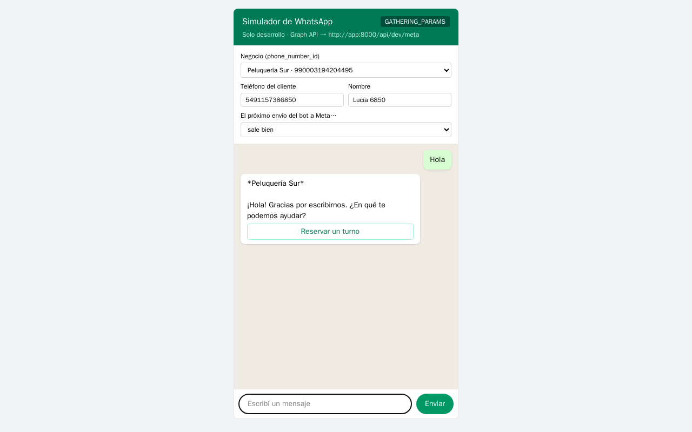
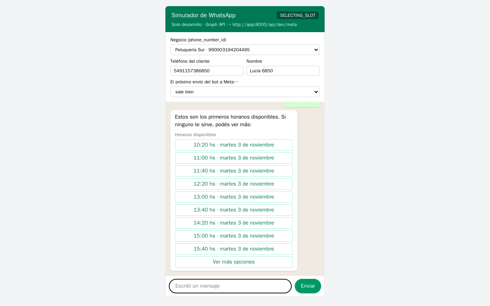
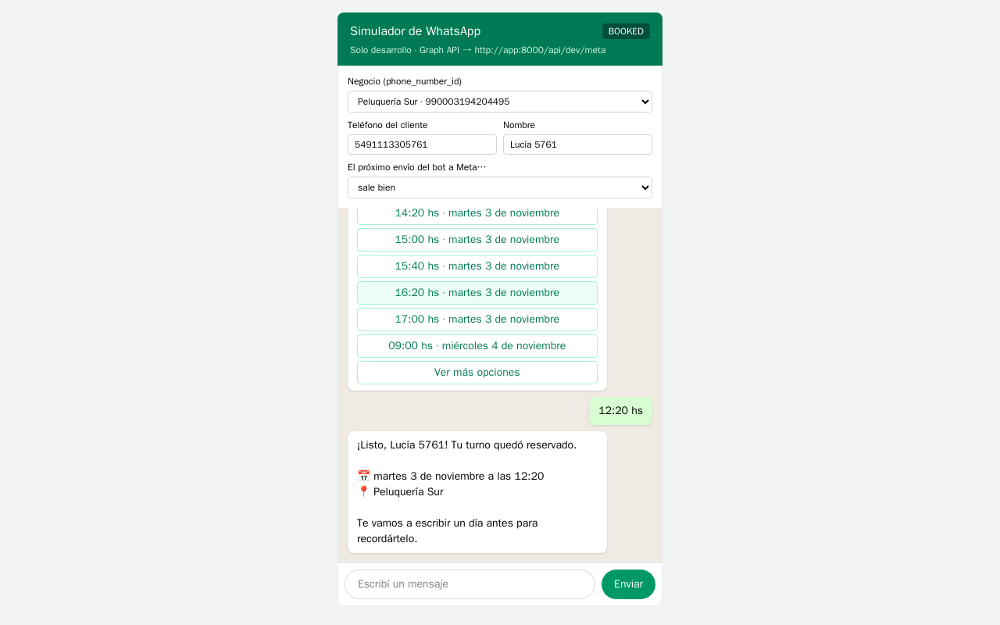
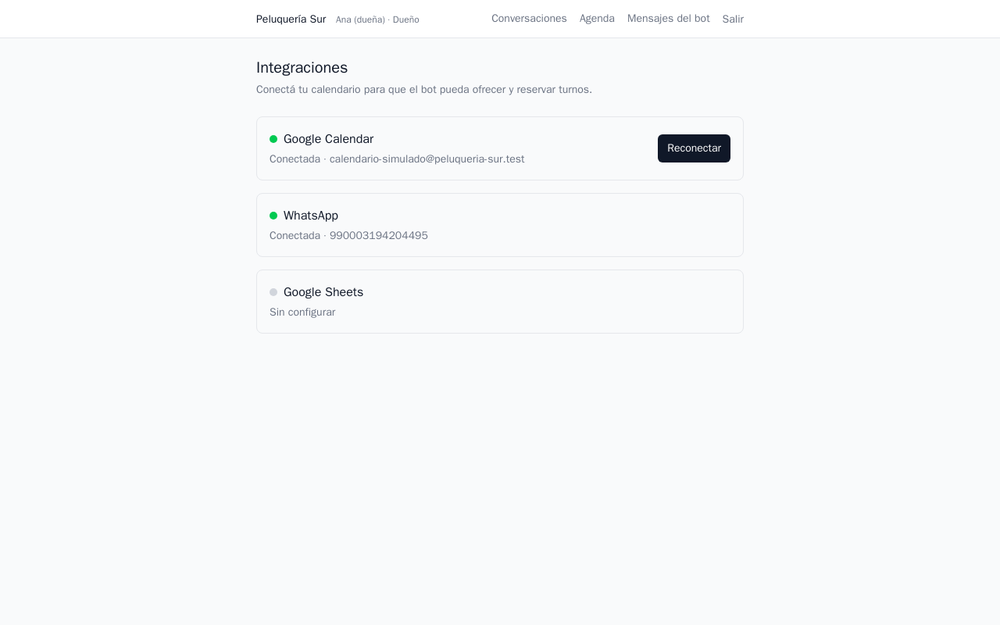
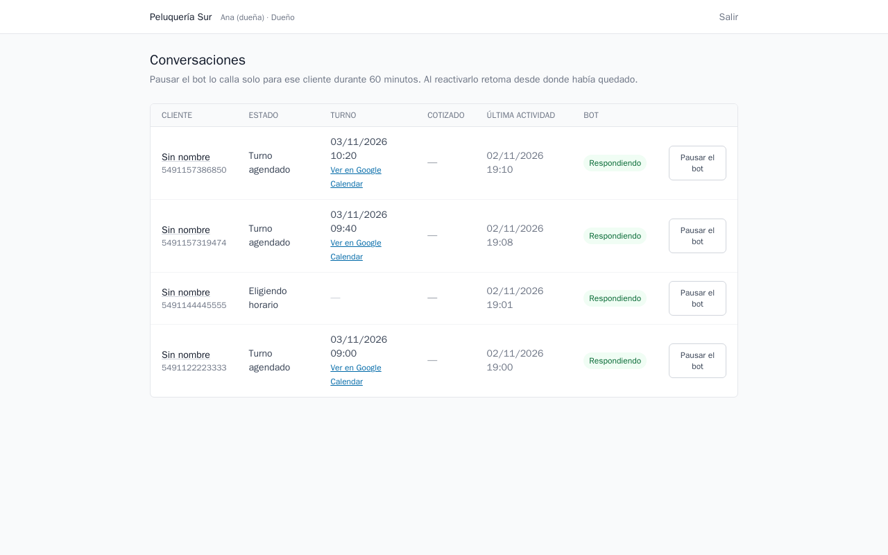
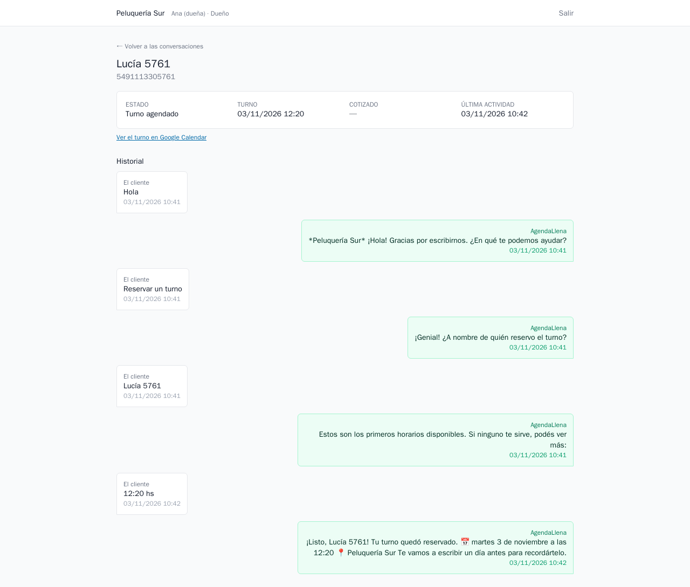
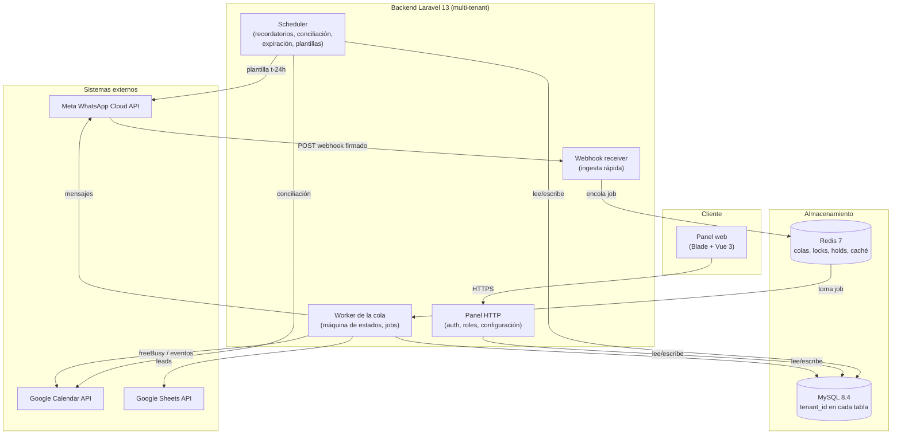
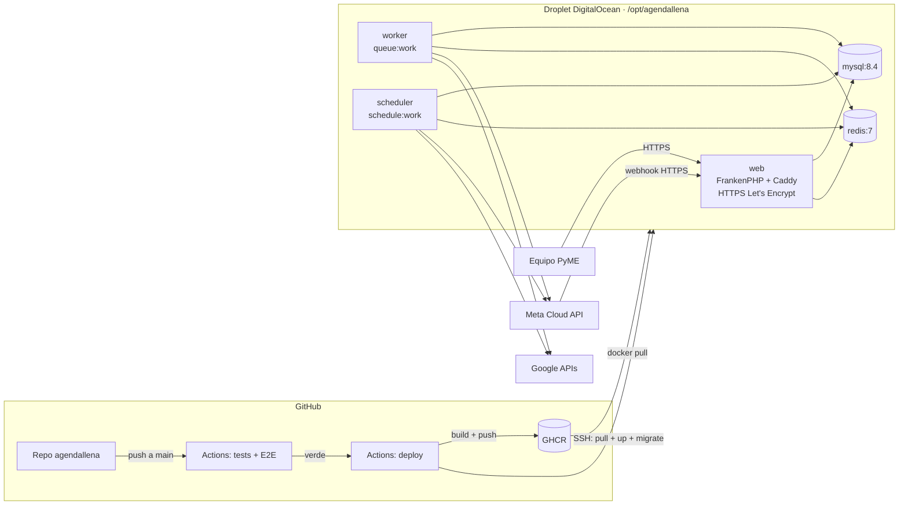
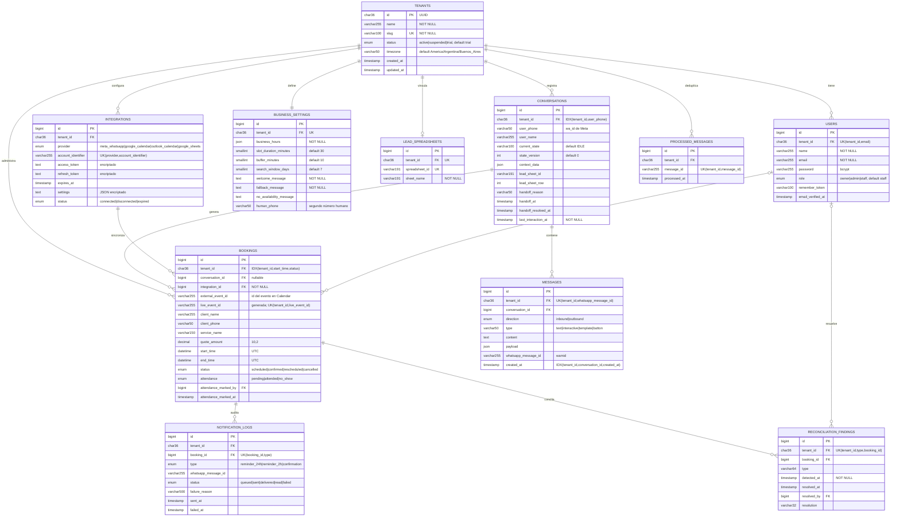

## Índice

0. [Ficha del proyecto](#0-ficha-del-proyecto)
1. [Descripción general del producto](#1-descripción-general-del-producto)
2. [Arquitectura del sistema](#2-arquitectura-del-sistema)
3. [Modelo de datos](#3-modelo-de-datos)
4. [Especificación de la API](#4-especificación-de-la-api)
5. [Historias de usuario](#5-historias-de-usuario)
6. [Tickets de trabajo](#6-tickets-de-trabajo)
7. [Pull requests](#7-pull-requests)

> **Dónde está cada cosa.** Este README es el resumen que pide la plantilla.
> - **Documentación completa:** [`.claude/docs/`](.claude/docs/README.md). Incluye PRD, lean canvas, C4, DER, flujos, 26 historias, 50 tickets, story maps, estimación y decisiones.
> - **Prompts:** [`prompts.md`](prompts.md), con los prompts clave de cada sección.
> - **Contexto de la IA:** [`CLAUDE.md`](CLAUDE.md), el contexto con el que trabajan los agentes del proyecto.
> - **Código:** en este mismo repo (`app/`, `resources/`, `database/`, `tests/`, `e2e/`), traído con su historial desde [diegomottadev/agendallena](https://github.com/diegomottadev/agendallena). El README técnico original, en inglés, está en [`docs/README-codigo.md`](docs/README-codigo.md).

---

## 0. Ficha del proyecto

### **0.1. Tu nombre completo:**

Diego Motta

### **0.2. Nombre del proyecto:**

AgendaLlena

### **0.3. Descripción breve del proyecto:**

Middleware de agendamiento por WhatsApp para PyMEs latinoamericanas de 3 a 20 empleados. El cliente escribe al WhatsApp del negocio y el bot le contesta en segundos. Le ofrece solo los horarios que están **realmente libres** en el Google Calendar del negocio, reserva el turno y lo confirma 24 horas antes con botones de Confirmar, Re-agendar y Cancelar. La PyME no cambia de herramientas: sigue usando su WhatsApp, su Google Calendar y su Google Sheets.

### **0.4. URL del proyecto:**

⚠️ **Todavía sin URL pública.** El despliegue en DigitalOcean está preparado y probado, pero falta crear el droplet y el subdominio (ver [2.4](#24-infraestructura-y-despliegue)).

Mientras tanto, el proyecto corre en local con Docker ([1.4](#14-instrucciones-de-instalación)), y el flujo completo se puede ver en el [video de la sección 1.3](#13-diseño-y-experiencia-de-usuario).

### 0.5. URL o archivo comprimido del repositorio

- **Este repo (código y documentación):** https://github.com/diegomottadev/agendallenaia
- Repo de desarrollo original: https://github.com/diegomottadev/agendallena

---

## 1. Descripción general del producto

### **1.1. Objetivo:**

Una PyME latinoamericana pierde plata por dos agujeros que nadie mide:

| Problema | Cuánto duele | Cómo se resuelve hoy |
| :-- | :-- | :-- |
| **Tarda horas en contestar un WhatsApp** | Quien pide un turno y no recibe respuesta en minutos le escribe al negocio de al lado | Alguien contesta cuando puede, entre cliente y cliente |
| **Entre el 20% y el 35% de los turnos no se presentan** | Una silla vacía que ya estaba paga | Nada; nadie llama para confirmar |
| **Rechaza los CRMs** | Ya les pidieron cambiar de herramienta y no lo hacen | WhatsApp y una planilla |

La tercera fila define el producto: **a una PyME no se le puede pedir que cambie de herramientas.**

**Propuesta de valor:** *agendar el 100% de las consultas de WhatsApp en menos de 15 segundos, sin cambiar de herramientas.*

**Para quién:** PyMEs de 3 a 20 empleados de salud y estética, inmobiliarias, distribuidoras B2B y servicios de mantenimiento.

**KPIs del MVP** ([PRD §2](.claude/docs/01-producto/02-prd.md)):
- Respuesta automática en menos de 15 s.
- Asistencia de al menos 92% en los pilotos (ausentismo por debajo del 8%).
- Al menos 35% de los chats terminan en reserva.
- Puesta en marcha de una PyME en menos de 60 minutos.

**Modelo de negocio** ([lean canvas](.claude/docs/01-producto/01-lean-canvas.md)): SaaS multi-tenant con un setup de USD 100-300 y un abono plano de USD 80-150 por mes.

### **1.2. Características y funcionalidades principales:**

**Cliente final (por WhatsApp)**

| Funcionalidad | Historia |
| :-- | :-- |
| **Bienvenida y menú** con botones interactivos de Meta | US-16 |
| **Horarios realmente libres:** consulta `freeBusy` de Google Calendar con horario de atención, duración y buffer, y los muestra en una lista interactiva con paginado | US-05, US-19 |
| **Reserva consistente:** hold de 5 minutos en Redis, control de colisión al confirmar y creación del evento en Calendar. Dos clientes no pueden quedarse con el mismo horario | US-06, US-18, US-22 |
| **Recordatorio t-24 h** con plantilla aprobada por Meta y botones Confirmar, Re-agendar y Cancelar. Cancelar libera el horario | US-10, US-11 |
| **Fallback:** si Google o Meta fallan, el cliente recibe un mensaje de cortesía y la conversación nunca queda colgada | US-09 |
| **Derivación a una persona** en un segundo número atendido por humanos | US-20 |

**Equipo de la PyME (panel web)**

| Funcionalidad | Historia |
| :-- | :-- |
| Login con roles **dueño, administrador y equipo**, con aislamiento estricto entre negocios | US-14 |
| Conversaciones: lista, detalle con historial completo, pausar y reactivar el bot | US-14, US-21 |
| Configuración de agenda (horarios, duración, buffer) y de mensajes (bienvenida, fallback, sin disponibilidad) | US-15 |
| Registro de asistencia y tasa de ausentismo | US-17 |
| Recordatorios que no salieron, con reintento | US-24 |
| Turnos en duda: una conciliación periódica detecta cuando Google y la base se desincronizaron | US-22 |
| Estado de las integraciones (Meta, Google Calendar, Google Sheets) | US-25 |
| Planilla de Google Sheets vinculada, donde se vuelcan los leads hayan reservado o no | US-13, US-26 |

**Plataforma**
- Webhook de Meta con handshake, firma HMAC y respuesta `200` antes de procesar (US-01, US-02).
- Máquina de estados declarada: 9 estados, transiciones explícitas, idempotencia y lock por conversación (US-03).
- Todo se guarda en UTC y se muestra en la zona del negocio, con una suite que detecta reglas de husos derogadas (US-07).
- **Simulador para desarrollo:** un chat de WhatsApp en `/dev/whatsapp` más mocks de Meta y de Google Calendar. El flujo completo se puede probar sin teléfono ni cuentas reales, y en producción esas rutas no existen.

**Fuera del MVP**, con la decisión documentada en el [PRD](.claude/docs/01-producto/02-prd.md): cotizador paramétrico, sincronización inversa por *watch* de Google, Outlook, cobro de señas y editor visual de flujos.

### **1.3. Diseño y experiencia de usuario:**

**Video del flujo principal** (18 s): un cliente reserva por WhatsApp y la dueña ve el turno en el panel. Lo grabó el test E2E mientras corría contra el sistema real; solo Meta y Google están simulados.


[Descargar en MP4](docs/capturas/flujo-principal.mp4)

**Paso a paso:**

| | |
| :-: | :-: |
| **1 · El cliente escribe y el bot da la bienvenida** con botones interactivos | **2 · Da su nombre y recibe solo horarios libres**, en una lista paginada |
|  |  |
| **3 · Elige un horario y el turno queda reservado** (evento creado en Calendar) | **4 · La dueña entra al panel** y ve el estado de sus integraciones |
|  |  |
| **5 · La conversación aparece con su turno** y el enlace al evento en Google Calendar | **6 · El detalle muestra el historial completo**, entrantes y salientes |
|  |  |

> ✅ **Corregido en la entrega 2:** el panel mostraba «Sin nombre» porque el nombre del cliente quedaba en `context_data` y en el turno, pero no en `conversations.user_name`, que es lo que lee el listado. Lo encontró el E2E y se corrigió con su test de regresión primero. En la captura 5, las filas con nombre son de después del arreglo; las «Sin nombre» se crearon antes y no se rellenaron.

⚠️ **Pendiente:** un video narrado de 2-3 minutos que recorra también el recordatorio t-24 h y la configuración del negocio.

Recorridos documentados:
- [Flujo de WhatsApp del cliente final](.claude/docs/03-flujos/04-flujo-whatsapp-cliente-final.md)
- [Máquina de estados](.claude/docs/03-flujos/05-estados-flujo-conversacional.md)
- [Secuencia end-to-end](.claude/docs/03-flujos/06-secuencia-agenda-cotizacion-e2e.md)
- Casos de uso: [general](.claude/docs/03-flujos/01-casos-de-uso-general.md), [cliente final](.claude/docs/03-flujos/02-casos-de-uso-cliente-final.md) y [equipo de la PyME](.claude/docs/03-flujos/03-casos-de-uso-equipo-pyme.md)

### **1.4. Instrucciones de instalación:**

**Requisitos:** Docker con Docker Compose. Todo lo demás corre en contenedores: PHP 8.4, MySQL 8.4, Redis 7 y, para el E2E, Playwright.

**1. Levantar el proyecto**

```bash
git clone https://github.com/diegomottadev/agendallenaia.git
cd agendallenaia
cp .env.example .env

docker compose up -d mysql redis
docker compose run --rm --no-deps app composer install
docker compose run --rm --no-deps app php artisan key:generate
docker run --rm -v "$PWD":/w -w /w node:22.12-bookworm-slim sh -c "npm ci && npm run build"   # assets del panel
```

**2. Activar el simulador**, para probar sin Meta ni Google reales. Agregá al `.env`:

```dotenv
META_APP_SECRET=dev-secret-local
META_SIMULADOR=true
META_GRAPH_URL=http://app:8000/api/dev/meta
META_SIMULADOR_WEBHOOK_URL=http://app:8000/api/v1/webhooks/whatsapp
GOOGLE_API_URL=http://app:8000/api/dev/google
```

**3. Base de datos, datos de demo y servicios**

```bash
docker compose up -d                                                   # app (:8000) + worker de la cola
docker compose exec app php artisan migrate --seed
docker compose exec app php artisan db:seed --class=RolesDemoSeeder    # 2 negocios demo, contraseña "password"
docker compose exec app php artisan dev:whatsapp:preparar              # WhatsApp y Google Calendar simulados por negocio
```

**4. Usarlo**

| Qué | Dónde |
| :-- | :-- |
| Chat de WhatsApp simulado | http://localhost:8000/dev/whatsapp |
| Panel | http://localhost:8000/login, con `duenia@peluqueria-sur.test` / `password` |
| Mensaje desde la terminal | `docker compose exec app php artisan dev:whatsapp "hola"` |

**5. Tests**

```bash
docker compose exec app php artisan test                     # suite completa, contra MySQL real (base agendallena_testing)
docker compose --profile e2e run --rm e2e                    # E2E con Playwright (necesita los pasos 2 y 3)
CAPTURAS=1 docker compose --profile e2e run --rm e2e         # además regenera las capturas de la sección 1.3
```

**Notas**
- Con integraciones reales, se completan en `.env` las credenciales `META_*` y `GOOGLE_*` y se quitan las variables del simulador.
- ⚠️ El `Dockerfile` usa `opcache.validate_timestamps=0`, así que el código editado no se ve hasta correr `docker compose restart app worker`.

---

## 2. Arquitectura del Sistema

### **2.1. Diagrama de arquitectura:**

C4 nivel 2, contenedores:



> Este diagrama refleja el sistema construido. Los C4 de [`.claude/docs/02-arquitectura/`](.claude/docs/02-arquitectura/) son los del diseño inicial e incluyen piezas diferidas del MVP: el cotizador, el detector automático de intervención humana y el webhook de *watch* de Google.

**Patrón:** **monolito modular** en Laravel con **ingesta orientada a eventos**: el webhook valida, encola y responde `200`, y el procesamiento ocurre en un worker. Las integraciones externas viven detrás de **adapters** (`MetaAdapter`, `CalendarioDeGoogle`, `PlanillaDeGoogle`), al estilo puertos y adaptadores. El dominio conversacional es una **máquina de estados declarada** (`TablaDeTransiciones`): una transición que no está en la tabla lanza una excepción, no se improvisa.

**Por qué esta arquitectura:**
- **Meta exige responder rápido** y reintenta lo que no recibe `200`. Encolar desacopla la latencia de Google y de Meta de la respuesta del webhook (RF-A2).
- **Un desarrollador y un MVP:** un monolito con una cola alcanza para el volumen de los pilotos y evita la operación de microservicios.
- **Multi-tenant por columna** (`tenant_id` más *Global Scopes* de Eloquent) en lugar de base o schema por cliente. Un solo despliegue sirve a todas las PyMEs con aislamiento lógico (RNF-01).

**Costos aceptados:**
- Los *Global Scopes* no cubren `DB::table()`, `whereRaw()` ni joins manuales; ahí el filtro va explícito y lo revisa el agente `invariantes-auditor`.
- Los jobs y el scheduler no heredan el tenant: viaja en el payload.
- Con un solo worker, una ráfaga grande espera en la cola. Escalar es agregar workers.
- No hay sincronización inversa por *watch* de Google. La reemplaza una **conciliación periódica** que marca los turnos movidos a mano como "en duda" para que una persona los resuelva.

### **2.2. Descripción de componentes principales:**

| Componente | Tecnología | Responsabilidad |
| :-- | :-- | :-- |
| **Webhook receiver** (`WhatsAppWebhookController` + `VerifyMetaSignature`) | Laravel 13 | Handshake (`hub.challenge`), validación de la firma `X-Hub-Signature-256` y encolado del payload. Responde `200` sin procesar. |
| **ProcessMessageJob** | Laravel Queues | Resuelve el tenant por `phone_number_id`, deduplica (`processed_messages`), toma el lock de la conversación y ejecuta la transición. |
| **Máquina de estados** (`App\Conversacion`) | PHP 8.4 | 9 estados (`IDLE`, `GATHERING_PARAMS`, `SELECTING_SLOT`, `SLOT_SELECTED`, `BOOKED`, `CONFIRMED`, `CANCELLED`, `PAUSED_HUMAN`, `ERROR_FALLBACK`), transiciones declaradas y `state_version` para descartar botones vencidos. |
| **Disponibilidad y reserva** (`App\Services\Agenda`, `App\Services\Google`) | Google Calendar API | `freeBusy`, grilla con horario, duración y buffer, hold temporal en Redis, colisión al confirmar y creación idempotente del evento. |
| **MetaAdapter** (`App\Meta`) | Meta Cloud API v21.0 | Texto, mensajes interactivos (botones y listas) y plantillas. Persiste lo saliente en `messages` y distingue el *rate limit* (se reintenta) del rechazo definitivo. |
| **Recordatorios** (`App\Recordatorios`) | Scheduler + plantillas de Meta | Recordatorio t-24 h y la respuesta a sus botones (confirmar, re-agendar, cancelar). |
| **Leads** (`App\Leads`, `VolcarLeadJob`) | Google Sheets API | Vuelca cada conversación con datos a la planilla del negocio. |
| **Panel** (`App\Http\Controllers\Panel`) | Blade + Vue 3 + Tailwind 4 (Vite 8) | Login, conversaciones, configuración, asistencia, recordatorios fallidos, turnos en duda e integraciones. |
| **Simulador** (`App\Dev`, `/dev/whatsapp`) | Laravel + JS | Chat de prueba y mocks de Graph API y Calendar. Solo en desarrollo. |
| **Logging estructurado** (`App\Logging`) | Monolog | Contexto por tenant e integración, y redacción de secretos antes de escribir. |

### **2.3. Descripción de alto nivel del proyecto y estructura de ficheros**

Estructura estándar de Laravel 13. El dominio se organiza **por capacidad de negocio**, no por tipo técnico:

```
app/
├── Conversacion/        # Dominio: máquina de estados, reserva, reagendamiento, fallback, derivación, pausa
│   └── Interactivo/     #   Botones y listas de Meta: renderizado e interpretación (ids sellados)
├── Meta/                # Adapter de WhatsApp Cloud API: envío, plantillas, alta de cuenta, números
├── Services/
│   ├── Agenda/          # Disponibilidad: freeBusy y grilla de slots
│   └── Google/          # Adapter de Google: OAuth, renovación de tokens, eventos, Sheets
├── Recordatorios/       # Plantilla t-24h y respuesta a sus botones
├── Leads/               # Fila de lead para Google Sheets
├── Panel/               # Lecturas del panel (estado de integraciones, etc.)
├── Jobs/                # ProcessMessageJob (ingesta), VolcarLeadJob
├── Console/Commands/    # Tareas del scheduler y comandos del simulador
├── Dev/                 # Simulador de Meta (solo desarrollo)
├── Http/
│   ├── Controllers/Api/   # Webhook de Meta y OAuth de Google
│   ├── Controllers/Panel/ # Pantallas del panel
│   ├── Controllers/Dev/   # Chat simulado y mocks de Meta y Google
│   └── Middleware/        # Firma de Meta, tenant de la sesión, roles, SoloConSimulador
├── Models/              # Eloquent; BelongsToTenant aplica el Global Scope por tenant_id
├── Logging/             # Logging estructurado y redacción de secretos
└── Support/             # TenantContext, HoraLocal (UTC ↔ zona del negocio)
database/migrations/     # Esquema: índices compuestos que lideran con tenant_id
resources/views, js/     # Panel: Blade + componentes Vue 3
tests/Feature/           # Suite de comportamiento contra MySQL real
e2e/                     # Playwright: E2E del flujo principal y capturas
docker/prod/             # Imagen de producción (FrankenPHP)
docs/despliegue.md       # Guía de despliegue en DigitalOcean
.claude/                 # Documentación de producto, agentes, skills y prompts
```

### **2.4. Infraestructura y despliegue**

**Desarrollo y CI.** `docker-compose.yml` levanta `app` (`artisan serve`), `worker` (`queue:work`), `mysql:8.4`, `redis:7-alpine` y, bajo el perfil `e2e`, Playwright. En GitHub Actions (`.github/workflows/tests.yml`), cada push y PR corre dos jobs:
1. **Suite completa** dentro de la imagen del proyecto, para que los tests de husos usen la misma tzdata que producción, más un paso aparte para los husos horarios.
2. **E2E con Playwright** con el simulador encendido. Guarda el reporte, el video y las trazas como artefactos.

**Producción: preparada, sin desplegar.** Un droplet de DigitalOcean con Docker:



- **Imagen** (`docker/prod/Dockerfile`, multi-stage): assets con Node, vendor sin dependencias de desarrollo y runtime **FrankenPHP 1.11**, que es PHP 8.4 con Caddy y da HTTPS automático (Meta lo exige para el webhook). Incluye `timezonedb` para tener la **tzdata 2026.6**: la versión que trae la imagen base es vieja y aplicaría reglas de husos derogadas.
- **Servicios** (`docker-compose.prod.yml`): `web`, `worker` y `scheduler` sobre la misma imagen, más `mysql` y `redis` con volúmenes persistentes.
- **CD** (`.github/workflows/deploy.yml`): después de que `tests` termina en verde sobre `main`, construye la imagen, la publica en GHCR y despliega por SSH (`pull`, `up -d`, `migrate --force`, `queue:restart`). **Está apagado** hasta que la variable `DEPLOY_ENABLED` valga `true`.
- **Secretos:** `.env` en el servidor con `chmod 600`; credenciales SSH en *GitHub Secrets*; tokens OAuth de cada PyME encriptados en la base. `.dockerignore` excluye todo `.env*`, y se verificó que la imagen no lo contiene.
- **Verificado en local:** la imagen construye, sirve el panel y los assets, y `/dev/whatsapp` devuelve `404` en producción.

Guía paso a paso (droplet, DNS, usuario de deploy, secretos, Meta y Google): [`docs/despliegue.md`](docs/despliegue.md).

⚠️ **Pendiente:** crear el droplet y el subdominio y encender el CD. Después, sumar backups automáticos de la base y alertas de worker y scheduler.

### **2.5. Seguridad**

| Práctica | Cómo está implementada |
| :-- | :-- |
| **Firma de los webhooks** | Todo `POST` de Meta se valida con HMAC SHA-256 (`X-Hub-Signature-256`) sobre el cuerpo crudo, en middleware y antes de tocar código de aplicación. Firma ausente o inválida → `401`. |
| **Handshake por tenant** | El `verify_token` se compara con `hash_equals` (tiempo constante) contra las integraciones de cada PyME. El token de un tenant no valida a otro. |
| **Tokens encriptados en reposo** | `access_token`, `refresh_token` y `settings` de `integrations` usan el cast `encrypted` y están en `$hidden`. |
| **Aislamiento multi-tenant** | El trait `BelongsToTenant` aplica un *Global Scope* y falla si no hay tenant activo. Cruzar tenants exige escribir `withoutTenantScope()` a propósito. Hay tests que verifican que un tenant no ve datos de otro. |
| **Roles en el panel** | Dueño, administrador y equipo, con el middleware `rol:*` ([roles y permisos](.claude/docs/01-producto/05-roles-y-permisos.md)). |
| **Secretos fuera de los logs** | El procesador `RedactSecrets` limpia tokens antes de escribir. Los errores nombran al tenant y al código HTTP, nunca al token. |
| **OAuth con `state` firmado** | El callback de Google valida el `state`, que además transporta el tenant. |
| **CSRF y sesión** | Activos en el panel. Los webhooks van en el grupo `api`, sin sesión: su autenticación es la firma. |
| **Ids de botones sellados** | `IdSellado`: un botón viejo o manipulado no ejecuta una acción fuera de su estado. |
| **Simulador cerrado en producción** | `SoloConSimulador` devuelve `404` en `/dev/*` con `APP_ENV=production`, aunque `META_SIMULADOR` quede encendido: un endpoint que firma webhooks no puede estar expuesto. |
| **Imagen sin secretos** | `.dockerignore` excluye `.env*`. En producción, `APP_DEBUG=false`, `expose_php=0` y cookies `secure`. |

### **2.6. Tests**

| Nivel | Herramienta | Qué cubre |
| :-- | :-- | :-- |
| **Comportamiento e integración** | PHPUnit 12, **más de 600 tests** en `tests/Feature/` | Corren **contra MySQL 8.4 real**, no SQLite, porque el esquema usa columnas generadas, ENUM y bloqueo de filas. Google y Meta se simulan con `Http::fake`. |
| **E2E** | **Playwright** (`e2e/`) | El flujo principal en un navegador real: reserva por WhatsApp y verificación en el panel. |
| **CI** | GitHub Actions | Los dos niveles en cada push y PR. |

El proyecto se desarrolló con **TDD estricto**, con agentes separados por fase: `tdd-test-writer` escribe el test que falla, `tdd-implementer` lo hace pasar y `tdd-refactorer` limpia.

Algunos tests representativos:

| Test | Qué garantiza |
| :-- | :-- |
| `e2e/tests/reserva-por-whatsapp.spec.ts` | **E2E:** el cliente saluda, toca "Reservar", da su nombre, elige un horario libre y recibe la confirmación. Después la dueña inicia sesión y ve la conversación con el turno y el enlace a Calendar. |
| `FlujoReservaTest` | El recorrido del bot a nivel HTTP, con Google y Meta simulados. |
| `ColisionDeHorarioTest` / `IdempotenciaDelAgendamientoTest` | Dos clientes no se quedan con el mismo horario, y un webhook repetido no reserva dos veces. |
| `ZonasHorariasTransversalTest` | Conversiones UTC ↔ zona local, incluidos países que eliminaron el horario de verano. Falla si la imagen retrocede de tzdata. |
| `WhatsAppWebhookIngestionTest` / `WhatsAppWebhookVerificationTest` | Firma inválida → `401`. Handshake con el token de otro tenant → `403`. |
| `RecordatorioT24hTest` / `RespuestaAlRecordatorioT24hTest` | Envío en ventana y sin duplicados. Confirmar pasa el turno a `confirmed`, cancelar libera el evento. |
| `FallbackTest` / `FallbackTercerosTest` | Si cae Google o Meta, el cliente recibe el mensaje de cortesía y la conversación vuelve a `IDLE`. |
| `SimuladorDeWhatsAppTest` | El webhook simulado pasa la firma real. Los mocks solo existen en desarrollo, y un turno reservado queda ocupado en el Calendar simulado. |

---

## 3. Modelo de Datos

### **3.1. Diagrama del modelo de datos:**

Esquema real de la base, con todas las migraciones aplicadas. No se muestran las tablas de infraestructura de Laravel (`jobs`, `cache`, `sessions`, etc.).



### **3.2. Descripción de entidades principales:**

Dos reglas valen para todas las tablas:
- **Multi-tenancy (RNF-01):** las tablas de negocio llevan `tenant_id` (FK a `tenants.id`, `NOT NULL` salvo en `users`), y los índices compuestos lideran con `tenant_id`.
- **Zonas horarias (RNF-02):** toda fecha se guarda en **UTC**. La zona del negocio vive en `tenants.timezone` y se aplica solo al mostrar.

| Entidad | Descripción | Relaciones y restricciones clave |
| :-- | :-- | :-- |
| **tenants** | Cada PyME cliente. PK UUID. | `slug` único. Tiene 1 `business_settings` y como mucho 1 `lead_spreadsheets`. |
| **users** | Personas del panel con rol `owner`, `admin` o `staff`. | N:1 con `tenants`. `UNIQUE(tenant_id, email)`: el mismo email puede existir en dos negocios. |
| **integrations** | Conexiones con Meta, Google Calendar y Google Sheets. `account_identifier` es el `phone_number_id` de Meta o el email de Google. | `UNIQUE(provider, account_identifier)`: un número pertenece a un solo negocio, y así la ingesta resuelve el tenant. Tokens y `settings` encriptados. |
| **business_settings** | Reglas del negocio: horario por día (JSON), duración del turno, buffer, ventana de búsqueda, textos del bot y segundo número humano. | 1:1 con `tenants`. |
| **lead_spreadsheets** | Planilla de Google Sheets donde se vuelcan los leads. | 1:1 con `tenants`. `spreadsheet_id` único. |
| **conversations** | La charla con cada cliente final: `current_state`, lo capturado en `context_data`, `state_version` para botones vencidos y marcas de derivación. | N:1 con `tenants`. `UNIQUE(tenant_id, user_phone)`: una conversación por teléfono y negocio, garantizada por la base. Es **la fuente de verdad del estado**; Redis solo hace de caché y lock. |
| **messages** | Historial completo de entrantes y salientes, con el payload original de Meta. | N:1 con `conversations`. `UNIQUE(tenant_id, whatsapp_message_id)`. Índice `(tenant_id, conversation_id, created_at)`. |
| **processed_messages** | Ids de Meta ya procesados: idempotencia ante los reintentos del webhook. | `UNIQUE(tenant_id, message_id)`. |
| **bookings** | Turno reservado y sincronizado con un evento de Google Calendar. | `live_event_id` es una **columna generada** que vale `external_event_id` solo si el turno está vivo. Su `UNIQUE(tenant_id, live_event_id)` impide dos turnos vivos sobre el mismo evento sin bloquear los cancelados. `attendance` va aparte de `status` para no perder que un turno confirmado terminó en ausencia. |
| **notification_logs** | Auditoría de recordatorios y confirmaciones, con el estado de entrega que informa Meta. | `UNIQUE(booking_id, type)`: un turno no recibe dos veces el mismo recordatorio. Índice `(tenant_id, status)` para el panel de fallidos. |
| **reconciliation_findings** | Desincronizaciones entre Google y la base ("turnos en duda") y su resolución. | N:1 con `bookings`. `resolved_by` es FK a `users`. `UNIQUE(tenant_id, type, booking_id)`. |

DDL completo y justificación de cada índice: [`04-modelo-de-datos.md`](.claude/docs/02-arquitectura/04-modelo-de-datos.md) (actualizado al esquema real el 2026-11-02).

**Deuda detectada al actualizarlo, corregida en la entrega 2** (migración `2026_11_03_100000`, con su test en rojo antes):
- `conversations (tenant_id, user_phone)` pasó a único: la ingesta usa `firstOrCreate`, que no es atómico, y dos primeros mensajes en ráfaga podían crear dos conversaciones.
- `notification_logs` suma `(tenant_id, status)`, que es el filtro del panel de recordatorios fallidos.

---

## 4. Especificación de la API

El backend expone pocos endpoints públicos; el resto es el panel, renderizado del lado del servidor con sesión. Los tres principales:

```yaml
openapi: 3.0.3
info:
  title: AgendaLlena API pública
  version: 1.0.0
servers:
  - url: http://localhost:8000/api/v1
paths:
  /webhooks/whatsapp:
    get:
      summary: Handshake del webhook de Meta (RF-A1)
      description: >
        Meta lo llama al registrar la URL. Si el verify_token corresponde a la
        integración de algún tenant, devuelve el challenge en texto plano.
      parameters:
        - { name: hub.mode, in: query, required: true, schema: { type: string, enum: [subscribe] } }
        - { name: hub.verify_token, in: query, required: true, schema: { type: string } }
        - { name: hub.challenge, in: query, required: true, schema: { type: string } }
      responses:
        '200':
          description: Token válido; devuelve el challenge.
          content: { text/plain: { schema: { type: string, example: "1158201444" } } }
        '403': { description: Parámetros incompletos o token que no corresponde a ningún tenant. }
    post:
      summary: Ingesta de mensajes y estados de WhatsApp (RF-A2)
      description: >
        Valida la firma HMAC SHA-256 sobre el cuerpo crudo, encola el payload
        (ProcessMessageJob) y responde 200 sin procesar. El tenant se resuelve
        por metadata.phone_number_id. Los reintentos de Meta se deduplican por id.
      parameters:
        - name: X-Hub-Signature-256
          in: header
          required: true
          schema: { type: string, example: "sha256=5f1c...e9" }
      requestBody:
        required: true
        content:
          application/json:
            example:
              object: whatsapp_business_account
              entry:
                - changes:
                    - field: messages
                      value:
                        metadata: { phone_number_id: "1053554814514902" }
                        contacts: [ { profile: { name: "María" }, wa_id: "5493764000000" } ]
                        messages:
                          - from: "5493764000000"
                            id: "wamid.HBgM..."
                            timestamp: "1793655028"
                            type: interactive
                            interactive:
                              type: list_reply
                              list_reply: { id: "slot_1793707200|SELECTING_SLOT|4", title: "09:00 hs" }
      responses:
        '200': { description: Recibido y encolado (también ante un cuerpo no decodificable, para que Meta no reintente). }
        '401': { description: Firma ausente o inválida. }
  /oauth/google/callback:
    get:
      summary: Callback del consentimiento de Google Calendar (RF-B1)
      description: >
        Google redirige acá después del consentimiento. El state firmado
        autentica la operación y transporta el tenant; se canjea el code por
        tokens, que se guardan encriptados en integrations.
      parameters:
        - { name: code, in: query, required: false, schema: { type: string } }
        - { name: state, in: query, required: true, schema: { type: string } }
        - { name: error, in: query, required: false, schema: { type: string, example: access_denied } }
      responses:
        '302':
          description: >
            Vuelve al panel. Con la integración conectada, o con
            ?google=cancelado si el usuario rechazó el consentimiento, o con
            ?google=error&motivo=state_invalido si el state no es válido.
```

---

## 5. Historias de Usuario

El backlog completo son **26 historias** en formato Como/Quiero/Para, con criterios BDD, requisitos técnicos, estimación, evaluación INVEST y trazabilidad al PRD ([índice](.claude/docs/01-producto/03-user-stories-mvp.md) · [story maps](.claude/docs/stories-maps/README.md)). Tres de las principales:

**Historia de Usuario 1 · [US-03 · Máquina de estados conversacional](.claude/docs/stories/US-03-maquina-de-estados-conversacional.md)**

| Prioridad | Estimación | Trazabilidad |
| :-- | :-- | :-- |
| 3 de 14 | L | RF-A3 · RF-A5 |

> **Como** cliente final que consulta por WhatsApp entre otras cosas,
> **quiero** que el bot recuerde exactamente en qué punto quedó nuestra conversación,
> **para** no tener que repetir lo que ya contesté ni quedar trabado sin salida.

- **AC-03.1 · Retomar tras una pausa larga.** **Dado que** dejé la conversación en `GATHERING_PARAMS` hace 20 minutos habiendo dado mi nombre, **cuando** vuelvo a escribir, **entonces** el bot retoma en ese estado y no me pide los datos de nuevo.
- **AC-03.2 · Botón vencido.** **Dado que** la conversación avanzó a `SELECTING_SLOT`, **cuando** toco un botón de un mensaje anterior, **entonces** el bot responde con el paso actual y no ejecuta la acción vieja.
- **AC-03.3 · Aislamiento entre conversaciones.** **Dado que** dos clientes escriben al mismo tenant en paralelo, **cuando** ambos avanzan, **entonces** cada conversación mantiene su estado sin interferir con la otra.
- **AC-03.4 · Entrada inesperada.** **Dado que** envío un texto que no corresponde a ninguna transición válida, **cuando** se procesa, **entonces** el bot recuerda qué se espera en ese paso y el estado no cambia.

**Historia de Usuario 2 · [US-05 · Ofrecer solo horarios que existen de verdad](.claude/docs/stories/US-05-horarios-realmente-libres.md)**

| Prioridad | Estimación | Trazabilidad |
| :-- | :-- | :-- |
| 5 de 14 | L | RF-B2 · RF-A5 |

> **Como** cliente final que pide un turno por WhatsApp,
> **quiero** ver solamente horarios que estén realmente disponibles,
> **para** no reservar uno que ya estaba ocupado y tener que reorganizar mi día después.

- **AC-05.1 · Respetar lo ocupado.** **Dado que** el calendario tiene un evento de 10:00 a 11:00, **cuando** pido turnos para ese día, **entonces** no aparece ningún horario que se superponga con esa franja.
- **AC-05.2 · Buffer entre turnos.** **Dado que** el buffer es de 10 minutos y un turno termina a las 11:00, **cuando** se calculan los horarios, **entonces** el primero ofrecido es a las 11:10 o después.
- **AC-05.3 · Horario de atención.** **Dado que** el negocio atiende de 09:00 a 18:00, **cuando** pido turnos, **entonces** no se ofrece nada fuera de esa franja ni en días no laborables.
- **AC-05.4 · Lista interactiva.** **Dado que** hay más horarios que el máximo de un List Message de Meta, **cuando** se envía la lista, **entonces** se muestran los primeros y una opción para ver más, sin que el mensaje falle.

INVEST: 2 de 6. Fallaba *Pequeña* porque mezclaba tres preocupaciones, y se partió en T-015 (configuración), T-022 (disponibilidad) y T-023 (lista).

**Historia de Usuario 3 · [US-10 · El recordatorio que baja el ausentismo](.claude/docs/stories/US-10-recordatorio-t24h.md)**

| Prioridad | Estimación | Trazabilidad |
| :-- | :-- | :-- |
| 10 de 14 | M | RF-D1 · CA-05 |

> **Como** cliente final con un turno reservado,
> **quiero** recibir un recordatorio el día anterior con opciones para responder,
> **para** confirmar o avisar que no puedo sin tener que llamar por teléfono en horario de atención.

- **AC-10.1 · Envío en ventana.** **Dado que** un turno está a 24 h (±10 min), **cuando** corre la tarea programada, **entonces** se envía la plantilla con los botones Confirmar, Re-agendar y Cancelar.
- **AC-10.2 · Confirmación.** **Dado que** recibí el recordatorio, **cuando** toco "Confirmar", **entonces** el turno pasa a `confirmed` y recibo un acuse.
- **AC-10.3 · Cancelación libera el horario.** **Dado que** recibí el recordatorio, **cuando** toco "Cancelar", **entonces** el evento se elimina de Google Calendar y el horario vuelve a estar disponible.
- **AC-10.4 · Sin duplicados ni envíos tardíos.** **Dado que** un turno se creó con menos de 24 h de anticipación o ya recibió su recordatorio, **cuando** corre la tarea, **entonces** no se envía un duplicado ni uno fuera de ventana.

---

## 6. Tickets de Trabajo

Los **50 tickets** se derivaron de las historias, partiendo las que fallaban INVEST. Cada uno tiene story points, dependencias, sprint y clasificación Pareto (núcleo o diferido) ([índice](.claude/docs/tickets/README.md) · [tabla maestra](.claude/docs/estimacion-backlog/01-tabla-maestra-de-tickets.md) · [análisis Pareto](.claude/docs/estimacion-backlog/03-analisis-pareto.md)). Uno de backend, uno de frontend y uno de base de datos:

**Ticket 1 · Backend · [T-022 · Consulta de disponibilidad: `freeBusy` y grilla de slots](.claude/docs/tickets/Finish/022-consulta-de-disponibilidad.md)**

| Prioridad | Sprint | Tipo | Historia | Puntos | Depende de | Bloquea a | Pareto |
| :-- | :-- | :-- | :-- | :-- | :-- | :-- | :-- |
| 22 | 3 | Feature | US-05 | 5 | T-005, T-012, T-015 | T-023, T-026, T-029 | Núcleo · ola 3 |

*Contexto.* Es el corazón de "sin cambiar tus herramientas": se lee el calendario del cliente tal como lo usa hoy. Ofrecer un horario ocupado es peor que no ofrecer nada.

*Alcance.*
- Consulta `POST /freeBusy` con la ventana en UTC y el `timeZone` del tenant.
- Grilla con horario de atención, duración y buffer, menos los bloques ocupados.
- Conversión a la zona local del tenant.

*Criterios de aceptación.*
- [x] Con un evento de 10:00 a 11:00, ningún horario ofrecido se superpone con esa franja *(AC-05.1)*.
- [x] Con buffer de 10 min y un turno que termina a las 11:00, el primer horario es 11:10 o posterior *(AC-05.2)*.
- [x] Con atención de 09:00 a 18:00, no se ofrece nada fuera de esa franja ni en días no laborables *(AC-05.3)*.
- [x] Un horario bloqueado a mano en el calendario deja de ofrecerse *(UC-2.8)*.
- [x] La latencia se mantiene dentro del presupuesto medido en el spike T-005.

*Fuera de alcance.* Renderizado de la lista (T-023), caso sin disponibilidad (T-024) y colisión al confirmar (T-029).

*Riesgos.* Si hiciera falta caché de disponibilidad, aparece una dependencia: invalidarlo con los cambios del calendario, o se vuelven a ofrecer horarios ocupados.

**Ticket 2 · Frontend · [T-047 · Panel: listado de conversaciones](.claude/docs/tickets/Finish/047-panel-lista-de-conversaciones.md)**

| Prioridad | Sprint | Tipo | Historia | Puntos | Depende de |
| :-- | :-- | :-- | :-- | :-- | :-- |
| 47 | 8 | Feature | US-14 | 5 | T-018, T-026, T-041, T-046 |

*Contexto.* Sin panel, la tarifa plana deja de cerrar apenas se pasa de un puñado de cuentas porque el soporte se come el margen. También es donde se ve el aislamiento multi-tenant: un tenant viendo datos de otro es un incidente que termina el contrato.

*Alcance.*
- Listado paginado de las conversaciones del tenant.
- Por fila: estado actual, fecha del turno y monto cotizado.
- Enlace al evento en Google Calendar.
- Marca de intervención humana.

*Criterios de aceptación.*
- [x] Se ven **únicamente** las conversaciones del propio tenant, con estado, fecha del turno y monto *(AC-14.1)*.
- [x] Una conversación con turno ofrece un enlace que abre el evento correcto en Google Calendar *(AC-14.3)*.
- [x] Una conversación pausada aparece marcada *(AC-14.4, parcial)*.
- [x] El listado no ejecuta consultas N+1 (`ConsultasNMas1Test`).
- [x] La paginación sostiene el volumen de un piloto sin degradarse.

*Fuera de alcance.* El detalle con historial (T-049), que depende de la tabla de T-048.

**Ticket 3 · Base de datos · [T-048 · Migración: tabla `messages`](.claude/docs/tickets/Finish/048-migracion-tabla-messages.md)**

| Prioridad | Sprint | Tipo | Historia | Puntos | Bloquea a |
| :-- | :-- | :-- | :-- | :-- | :-- |
| 48 | 8 | Migración | habilita US-14 (AC-14.4) | 2 | T-049 |

*Contexto.* AC-14.4 promete "el historial completo de mensajes" y no existía tabla de mensajes: `conversations` guarda el estado de la conversación, no la conversación.

*Alcance.*
- Migración `messages` con `tenant_id`, `conversation_id`, dirección, contenido, payload y `whatsapp_message_id`.
- Índice `(tenant_id, conversation_id, created_at)`.
- Persistencia de entrantes y salientes desde el worker.
- Política de retención.

*Criterios de aceptación.*
- [x] La tabla existe con `tenant_id`, su FK a `conversations` y el Global Scope aplicado.
- [x] Cada mensaje entrante y saliente queda persistido con su dirección y su id de Meta (`UNIQUE(tenant_id, whatsapp_message_id)`).
- [x] Un mensaje recibido durante una pausa humana queda registrado aunque el bot no responda *(AC-08.1)*.
- [x] La consulta del historial usa el índice y no escanea la tabla.
- [ ] La política de retención está definida y documentada.

*Riesgo.* Es la tabla de mayor crecimiento y la única con contenido de conversaciones de terceros: hay que definir retención y borrado.

---

## 7. Pull Requests

**Pull Request 1 · [#1 Entrega 1: documentación técnica de AgendaLlena](https://github.com/diegomottadev/agendallenaia/pull/1)** (`feature-entrega1-DM` → `main`)

- **Qué cambia:** completa la plantilla (`readme.md` y `prompts.md`) y publica la documentación de producto de `.claude/` y el `CLAUDE.md`. Suma capturas y video del flujo principal, tomados del E2E.
- **Por qué:** la entrega 1 pide la idea, la estructura y el diseño. El proyecto se construyó spec-first (PRD → story maps → historias → tickets → tests → código), así que la documentación ya existía; el PR la publica en el formato de la plantilla.
- **Impacto:** solo documentación. Los prompts que no se habían guardado se reconstruyeron y están marcados como tales.

**Pull Request 2 · [#2 Entrega 2: código funcional de AgendaLlena](https://github.com/diegomottadev/agendallenaia/pull/2)** (`feature-entrega2-DM` → `feature-entrega1-DM`, apilado sobre #1)

- **Qué cambia:** trae el código con su historial completo desde el repo de desarrollo: backend Laravel, panel Vue, MySQL, 609 tests con TDD, un E2E con Playwright, el simulador de WhatsApp y Google Calendar, y el despliegue preparado. Incluye tres correcciones con su test en rojo antes: el «Sin nombre» del panel, el único en `conversations (tenant_id, user_phone)` y el índice `(tenant_id, status)` en `notification_logs`.
- **Por qué:** la entrega 2 pide backend, frontend y base de datos conectados, con el flujo principal funcionando. Se conservó el historial para que se vea cómo se construyó, ticket por ticket.
- **Impacto:** el flujo principal (reserva por WhatsApp hasta el turno en el panel) corre de punta a punta en local. Falta la URL pública, y el CI no corre por un bloqueo de facturación de la cuenta de GitHub.

**Pull Request 3** · ⚠️ *Entrega final.*
